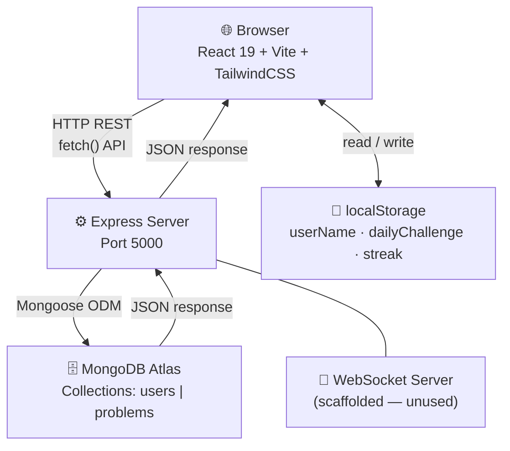
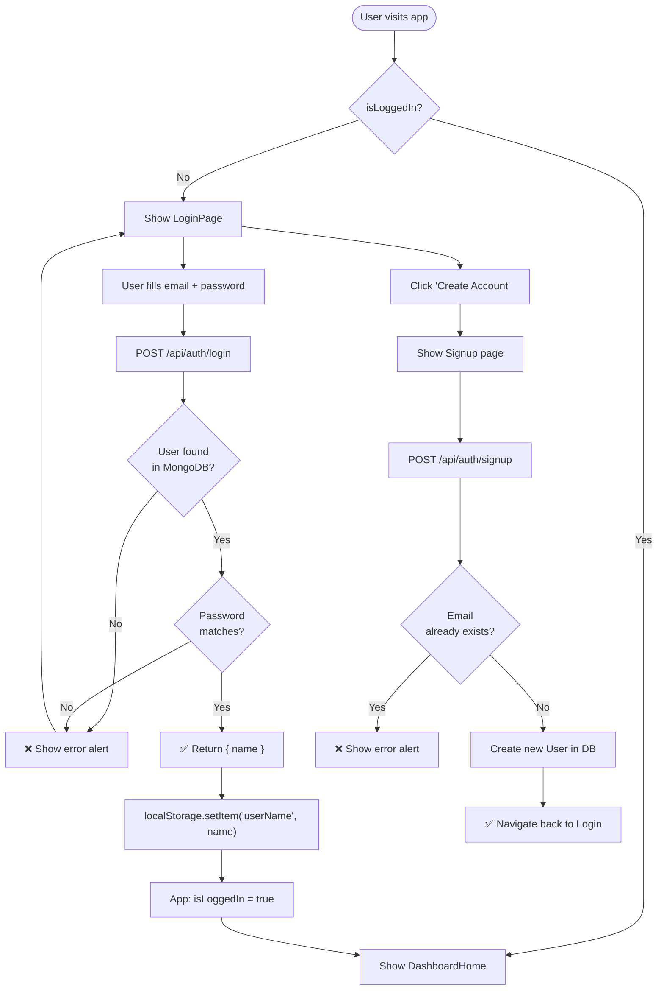
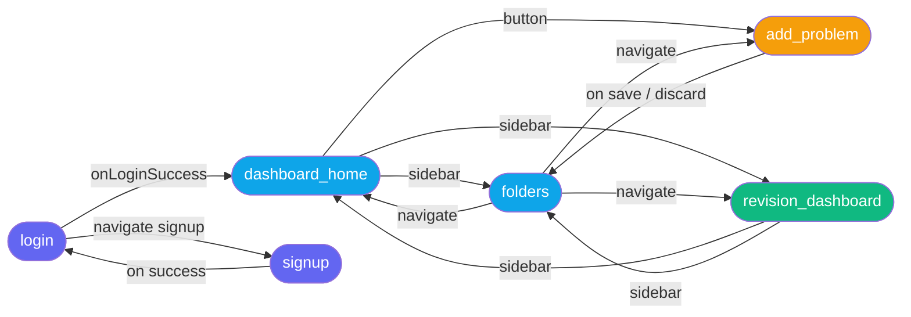
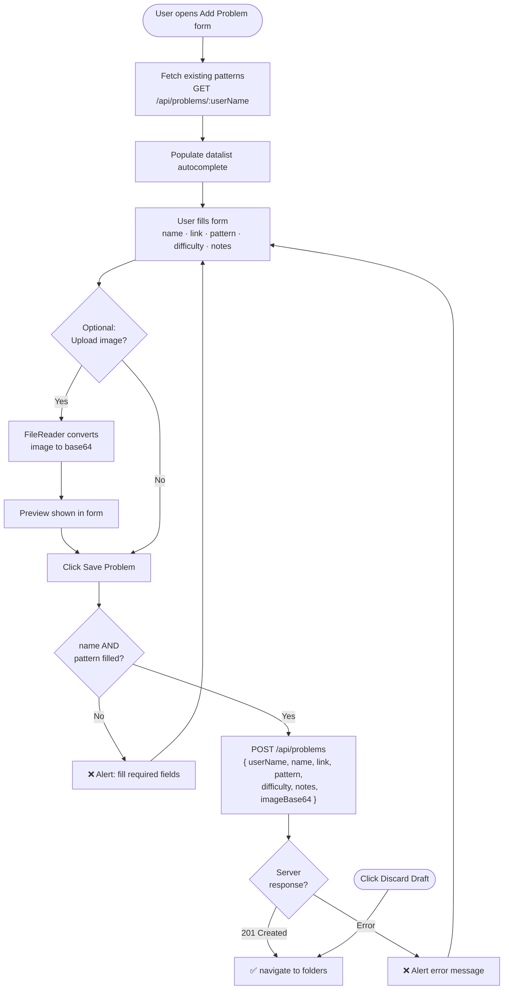
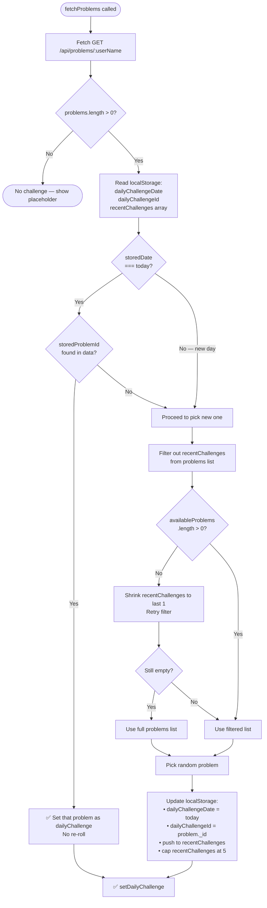
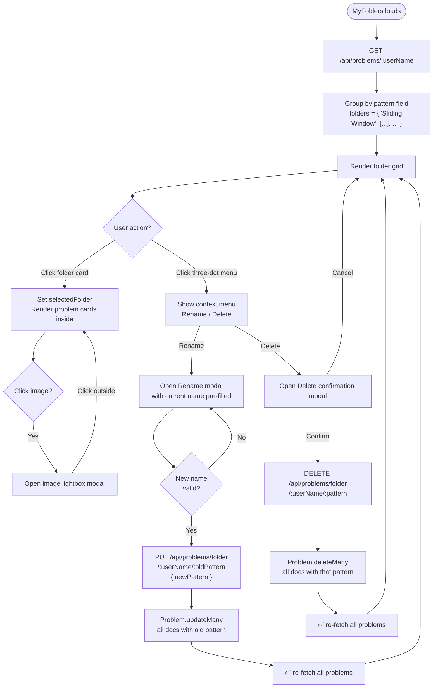

# AlgoRevis — System Design & Implementation Document

> **A personal DSA (Data Structures & Algorithms) revision tracker** built for disciplined engineers who want to track, organise, and intelligently revise their problem-solving history.

---

## Table of Contents

1. [Project Overview](#1-project-overview)
2. [High-Level Architecture](#2-high-level-architecture)
3. [Tech Stack](#3-tech-stack)
4. [Repository Structure](#4-repository-structure)
5. [Backend Design](#5-backend-design)
   - [Server Setup](#51-server-setup)
   - [Database Models](#52-database-models)
   - [API Routes](#53-api-routes)
6. [Frontend Design](#6-frontend-design)
   - [App Architecture & Navigation](#61-app-architecture--navigation)
   - [Component Breakdown](#62-component-breakdown)
7. [Core Feature Implementations](#7-core-feature-implementations)
   - [Authentication Flow](#71-authentication-flow)
   - [Problem Management (CRUD)](#72-problem-management-crud)
   - [Folder Management](#73-folder-management)
   - [Daily Challenge System](#74-daily-challenge-system)
   - [Streak Calculation](#75-streak-calculation)
8. [Data Flow Diagrams](#8-data-flow-diagrams)
9. [System Flowcharts](#9-system-flowcharts)
   - [Overall System Architecture](#91-overall-system-architecture)
   - [Authentication Flow](#92-authentication-flow)
   - [App Navigation & Routing](#93-app-navigation--routing)
   - [Add Problem Flow](#94-add-problem-flow)
   - [Daily Challenge Algorithm](#95-daily-challenge-algorithm)
   - [Folder Management Operations](#96-folder-management-operations)
10. [State Management](#10-state-management)
11. [Known Limitations & Future Work](#11-known-limitations--future-work)

---

## 1. Project Overview

**AlgoRevis** ("Algo Revision") is a full-stack web application designed to help developers track their LeetCode/DSA practice sessions. Users can:

- **Create an account** and log in securely.
- **Add problems** they have solved — with name, LeetCode link, difficulty, pattern/folder, notes, and an optional screenshot.
- **Organise problems into folders** (pattern-based, e.g., "Sliding Window", "Dynamic Programming").
- **Rename or delete** entire folders, which bulk-updates or bulk-deletes all problems in that folder.
- **View a Dashboard** with performance statistics, streak, and recent activity.
- **Use Revision Mode** — a dedicated view of the full revision queue with a "Daily Challenge" system that selects a randomly picked problem each day, avoiding repetition.

---

## 2. High-Level Architecture

```
┌─────────────────────────────────────────────────────────────────────┐
│                          CLIENT (Browser)                           │
│                                                                     │
│   React 19 + Vite + TailwindCSS v4                                  │
│                                                                     │
│   LoginPage → DashboardHome → MyFolders → AddNewProblemForm         │
│             ↘ RevisionModeDashboard → IndividualProblemReview       │
└──────────────────────────────┬──────────────────────────────────────┘
                               │  HTTP REST (fetch)
                               │  Port 5000
┌──────────────────────────────▼──────────────────────────────────────┐
│                     SERVER (Node.js + Express 5)                    │
│                                                                     │
│   /api/auth   →  auth.js (signup / login)                           │
│   /api/problems → problems.js (CRUD for problems & folders)         │
│                                                                     │
│   WebSocket Server (ws) — scaffolded, not yet consumed by frontend  │
└──────────────────────────────┬──────────────────────────────────────┘
                               │  Mongoose ODM
┌──────────────────────────────▼──────────────────────────────────────┐
│                  MongoDB Atlas (Cloud Database)                     │
│                                                                     │
│   Collections:  users  |  problems                                  │
└─────────────────────────────────────────────────────────────────────┘
```

---

## 3. Tech Stack

| Layer | Technology | Version | Notes |
|---|---|---|---|
| **Frontend framework** | React | 19.2.x | Uses functional components & hooks only |
| **Build tool** | Vite | 8.x | Dev server + production bundler |
| **Styling** | TailwindCSS | v4.2.x | Utility-first CSS; Material 3 token naming convention |
| **Backend runtime** | Node.js | LTS | CommonJS (`"type": "commonjs"`) |
| **Backend framework** | Express | 5.2.x | Async error propagation built-in |
| **Database** | MongoDB (Atlas) | Cloud | Mongoose ODM v9.x |
| **Real-time layer** | ws (WebSocket) | 8.x | Server-side scaffolded; unused by frontend currently |
| **Auth security (dep)** | bcryptjs, jsonwebtoken | Installed | Not yet wired in — passwords stored plain text |

---

## 4. Repository Structure

```
algo_revis/
├── backend/
│   ├── models/
│   │   ├── User.js          # Mongoose User schema
│   │   └── Problem.js       # Mongoose Problem schema
│   ├── routes/
│   │   ├── auth.js          # POST /signup, POST /login
│   │   └── problems.js      # CRUD for problems & folder operations
│   ├── server.js            # Express app entry point + WebSocket server
│   ├── package.json
│   └── .gitignore
│
└── frontend/
    ├── src/
    │   ├── App.jsx                     # Root component + view router
    │   ├── main.jsx                    # React DOM entry point
    │   ├── index.css                   # Global styles + Tailwind directives
    │   ├── App.css                     # App-level styles
    │   ├── LoginPage.jsx               # Auth: login form
    │   ├── Signup.jsx                  # Auth: registration form
    │   ├── DashboardHome.jsx           # Main dashboard view
    │   ├── MyFolders.jsx               # Folder grid + problem cards view
    │   ├── AddNewProblemForm.jsx       # Modal form to add a new problem
    │   ├── RevisionModeDashboard.jsx   # Revision queue view + daily challenge
    │   └── IndividualProblemReview.jsx # (Scaffolded) Single problem review
    ├── index.html
    ├── vite.config.js
    ├── package.json
    └── .gitignore
```

---

## 5. Backend Design

### 5.1 Server Setup

**File:** `backend/server.js`

The entry point bootstraps the Express app with the following middleware and config:

```
express.json({ limit: '50mb' })        ← large payload for imageBase64
express.urlencoded({ limit: '50mb' })  ← form data support
cors()                                 ← open CORS for local dev
/api/auth   → authRoutes
/api/problems → problemRoutes
/api/status → health check endpoint
WebSocketServer on same http.Server    ← real-time scaffold
mongoose.connect(MONGO_URI)            ← Atlas connection
server.listen(5000)
```

> **Note:** The MongoDB connection string is hardcoded with credentials currently embedded in `server.js`. This should be moved to a `.env` file before any deployment.

---

### 5.2 Database Models

#### `User` Model — `backend/models/User.js`

| Field | Type | Constraints |
|---|---|---|
| `name` | String | required |
| `email` | String | required, unique |
| `password` | String | required (plain text — not hashed yet!) |
| `createdAt` | Date | auto via `timestamps: true` |
| `updatedAt` | Date | auto via `timestamps: true` |

#### `Problem` Model — `backend/models/Problem.js`

| Field | Type | Constraints |
|---|---|---|
| `userName` | String | required — acts as owner FK (denormalised) |
| `name` | String | required — problem title |
| `link` | String | optional — LeetCode/problem URL |
| `pattern` | String | required — used as the "folder" grouping key |
| `difficulty` | String | enum: `Easy`, `Medium`, `Hard`; default `Medium` |
| `notes` | String | optional — user's approach notes |
| `imageBase64` | String | optional — base64-encoded screenshot |
| `createdAt` | Date | default: `Date.now` |

> **Design decision:** `userName` is used as a denormalised string key instead of a MongoDB ObjectId reference to `User`. This simplifies queries but makes the system vulnerable to orphaned problems if a user changes their name or is deleted.

---

### 5.3 API Routes

#### Auth Routes — `/api/auth`

| Method | Endpoint | Description |
|---|---|---|
| `POST` | `/api/auth/signup` | Creates a new user. Validates email uniqueness. Returns 201 on success. |
| `POST` | `/api/auth/login` | Validates email + plain-text password. Returns `{ message, name }` on success. |

**Current limitation:** Passwords are stored and compared in plain text. `bcryptjs` is installed but unused.

---

#### Problem Routes — `/api/problems`

| Method | Endpoint | Description |
|---|---|---|
| `POST` | `/api/problems` | Create a new problem. Requires `userName`, `name`, `pattern`. |
| `GET` | `/api/problems/:userName` | Get all problems for a user, sorted by `createdAt` descending. |
| `PUT` | `/api/problems/folder/:userName/:oldPattern` | Bulk rename — updates `pattern` on all matching problems for the user. |
| `DELETE` | `/api/problems/folder/:userName/:pattern` | Bulk delete — removes all problems under this folder for the user. |

> **Important route ordering note:** Express 5 route matching can be ambiguous between `/folder/:userName/:pattern` and `/:userName`. Since the folder routes come first in the file, they match before the generic `/:userName` GET route — this works correctly as long as no user is named `"folder"`.

---

## 6. Frontend Design

### 6.1 App Architecture & Navigation

The app uses a **custom client-side view router** built entirely in `App.jsx` with React `useState`. There is **no React Router** involved. Navigation state is a single string `currentView`.

```
currentView values:
  'login'              ← default, shown to unauthenticated users
  'signup'
  'dashboard_home'     ← landing after login
  'folders'
  'add_problem'
  'revision_dashboard'
  'problem_review'
```

`isLoggedIn` boolean gates all authenticated routes. After login, `userName` is stored in `localStorage` and used across all components for API queries.

A floating **debug navigation bar** is rendered in the bottom-right corner when logged in (`App.jsx`, lines 28–36). This is a development convenience and should be removed in production.

```jsx
// App.jsx — navigation model
const [currentView, setCurrentView] = useState('login');
const [isLoggedIn, setIsLoggedIn] = useState(false);

// Each view renders only when its condition is met:
{isLoggedIn && currentView === 'folders' && <MyFolders navigate={setCurrentView} />}
```

All components receive `navigate` as a prop, which is simply `setCurrentView` — allowing any component to trigger a view transition.

---

### 6.2 Component Breakdown

#### `LoginPage.jsx`
- Controlled form with `email` and `password` state
- On submit: `POST /api/auth/login` → stores `data.name` in `localStorage` → calls `onLoginSuccess()` which sets `isLoggedIn = true` and navigates to `dashboard_home`
- Links to `Signup` via `navigate('signup')`

#### `Signup.jsx`
- Similar to LoginPage — `POST /api/auth/signup`
- On success navigates to `login`

#### `DashboardHome.jsx`
- On mount: reads `userName` from localStorage, fetches `/api/problems/:userName`
- Computes derived data locally:
  - `totalProblems`, `easyCount`, `mediumCount`, `hardCount`
  - `recentFolders` — first 3 unique patterns
  - `recentProblemsList` — first 4 problems (already sorted desc by server)
  - `currentStreak` — via `calculateStreak()` helper
- Renders: welcome header, streak badge, stats bento grid, recent folders, recent problems

#### `MyFolders.jsx`
- Fetches all problems on mount (same as DashboardHome)
- Groups problems into a `folders` object keyed by `pattern`:
  ```js
  const folders = problems.reduce((acc, prob) => {
    if (!acc[prob.pattern]) acc[prob.pattern] = [];
    acc[prob.pattern].push(prob);
    return acc;
  }, {});
  ```
- **Folder grid view** — clicking a folder sets `selectedFolder` and renders the folder detail view
- **Folder detail view** — grid of problem cards with image, notes, difficulty badge, and solve link
- **Context menu** on each folder card (three-dot `more_vert` icon):
  - **Rename** → opens `folderToEdit` modal → calls `PUT /api/problems/folder/:userName/:oldPattern`
  - **Delete** → opens `folderToDelete` confirmation modal → calls `DELETE /api/problems/folder/:userName/:pattern`
- **Image lightbox** — clicking a problem's image opens `zoomedImage` state → fullscreen modal
- Also runs the **Daily Challenge logic** (shared with `RevisionModeDashboard`)

#### `AddNewProblemForm.jsx`
- On mount: fetches existing patterns to populate `<datalist>` for pattern autocomplete
- Form fields: `name`, `link`, `pattern`, `difficulty` (toggle buttons), `notes`, `imageBase64` (file upload → converted via `FileReader`)
- On save: `POST /api/problems` → navigates to `folders` on success
- Visually renders a **blurred/greyed-out folders background** behind a modal overlay for context

#### `RevisionModeDashboard.jsx`
- Fetches all problems for the user on mount
- Renders a **Revision Queue** — all problems list with difficulty badges and solve links
- Contains the **Daily Challenge card** (sidebar right)
- Shows **live streak count** via `calculateStreak()`
- Runs the exact same Daily Challenge selection logic as `MyFolders`

#### `IndividualProblemReview.jsx`
- Scaffolded — exists in the codebase but not yet functionally implemented in the navigation flow

---

## 7. Core Feature Implementations

### 7.1 Authentication Flow

```
User fills Login form
    → POST /api/auth/login { email, password }
    → Server: User.findOne({ email }) → compare plain-text password
    → Response: { message: "Login successful", name: "Harsh" }
    → Client: localStorage.setItem('userName', 'Harsh')
    → App.isLoggedIn = true → navigate('dashboard_home')
```

**Session persistence:** There is **no JWT or session token**. The only persistence between page refreshes is the `userName` in `localStorage`. If the page is refreshed, `isLoggedIn` resets to `false` and the user is sent back to the login page, despite `userName` being present in storage.

---

### 7.2 Problem Management (CRUD)

```
CREATE  →  AddNewProblemForm → POST /api/problems
READ    →  All components fetch GET /api/problems/:userName on mount
UPDATE  →  MyFolders folder rename → PUT /api/problems/folder/:u/:oldPattern
DELETE  →  MyFolders folder delete → DELETE /api/problems/folder/:u/:pattern
```

There is currently **no individual problem edit or delete** — only bulk folder-level operations.

---

### 7.3 Folder Management

Folders are **not a separate database collection**. They are a virtual concept derived from the `pattern` field on `Problem` documents. The value of `problem.pattern` serves as the folder name.

- **Creating a folder** = adding the first problem with a new `pattern` value
- **Renaming a folder** = `Problem.updateMany({ userName, pattern: oldPattern }, { $set: { pattern: newPattern } })`
- **Deleting a folder** = `Problem.deleteMany({ userName, pattern })`

This means deleting a folder **permanently deletes all problems in it**.

---

### 7.4 Daily Challenge System

This logic is duplicated identically in both `MyFolders.jsx` and `RevisionModeDashboard.jsx`. It uses `localStorage` to persist state across page loads within the same day.

```
On fetchProblems() success:

1. Get today's date string (YYYY-MM-DD)
2. Check localStorage:
     dailyChallengeDate  ← last date a challenge was set
     dailyChallengeId    ← the problem _id chosen that day
     recentChallenges    ← JSON array of last 5 chosen _ids

3. IF storedDate === today AND storedProblemId exists:
     → Find that problem in fetched data and set as dailyChallenge (no re-roll)

4. ELSE (new day or first time):
     → Filter out recentChallenges from available problems
     → If none left: shrink recentChallenges to last 1, retry
     → If still none: use full problem list
     → Pick a random problem from availableProblems
     → Update localStorage: date, id, recentChallenges (capped at 5)
     → setDailyChallenge(randomProb)
```

**Purpose:** Ensures a different problem is shown each day, and avoids showing recently-seen problems. The 5-problem history window prevents the same problems from appearing in consecutive days.

---

### 7.5 Streak Calculation

Also duplicated across `DashboardHome`, `MyFolders`, and `RevisionModeDashboard`:

```js
const calculateStreak = (problemsArray) => {
  // 1. Extract unique dates (YYYY-MM-DD) from createdAt timestamps
  // 2. Sort descending
  // 3. Start from today — if no problem added today, check yesterday
  // 4. Walk backwards counting consecutive days that have at least 1 problem
  // 5. Return streak count
};
```

**Definition of streak:** Number of consecutive calendar days on which at least one problem was **created** (not necessarily solved). This uses `createdAt` date, not a dedicated "solved on" date.

---

## 8. Data Flow Diagrams

### Login Flow
```
LoginPage
  │  POST /api/auth/login
  ▼
auth.js (Express route)
  │  User.findOne({ email })
  ▼
MongoDB (users collection)
  │  { name, email, password }
  ▼
auth.js: compare password (plain text)
  │  res.json({ name })
  ▼
LoginPage: localStorage.setItem('userName', name)
  │  onLoginSuccess()
  ▼
App.jsx: isLoggedIn=true, currentView='dashboard_home'
```

### Problem Add Flow
```
AddNewProblemForm
  │  POST /api/problems { userName, name, link, pattern, difficulty, notes, imageBase64 }
  ▼
problems.js (Express route)
  │  new Problem({...}).save()
  ▼
MongoDB (problems collection)
  │  201 Created
  ▼
AddNewProblemForm: navigate('folders')
```

### Folder Rename Flow
```
MyFolders (user clicks Rename in context menu)
  │  PUT /api/problems/folder/:userName/:oldPattern { newPattern }
  ▼
problems.js
  │  Problem.updateMany({ userName, pattern: oldPattern }, { $set: { pattern: newPattern } })
  ▼
MongoDB: all matching documents updated
  │  { modifiedCount }
  ▼
MyFolders: setFolderToEdit(null) → fetchProblems() (re-fetch all)
```

---

## 9. System Flowcharts

### 9.1 Overall System Architecture



---

### 9.2 Authentication Flow



---

### 9.3 App Navigation & Routing



---

### 9.4 Add Problem Flow



---

### 9.5 Daily Challenge Algorithm



---

### 9.6 Folder Management Operations



---

## 10. State Management

The app uses **React local state only** (`useState`, `useEffect`). There is no global state library (no Redux, no Zustand, no Context API used).

| State | Location | Scope |
|---|---|---|
| `isLoggedIn` | `App.jsx` | Global — gates all authenticated views |
| `currentView` | `App.jsx` | Global — drives the entire navigation |
| `userName` | `localStorage` | Persistent across page loads (but no session token) |
| `problems` | Each view component | Local — re-fetched on every mount |
| `dailyChallenge` | `MyFolders`, `RevisionModeDashboard` | Local + localStorage for persistence |
| `dailyChallengeDate/Id/recentChallenges` | `localStorage` | Cross-session daily persistence |
| Form fields (`name`, `link`, etc.) | `AddNewProblemForm` | Local |
| Folder UI state (`selectedFolder`, `openFolderMenu`, etc.) | `MyFolders` | Local |

---

## 11. Known Limitations & Future Work

### Security
- [ ] **Passwords are stored in plain text.** `bcryptjs` is installed — hashing must be implemented before any real use.
- [ ] **No JWT or session tokens.** After a page refresh, the user is logged out despite `userName` being in localStorage. A proper token-based auth system should be implemented.
- [ ] **MongoDB URI is hardcoded** in `server.js` with credentials. Move to `.env` + `dotenv`.
- [ ] **No input sanitisation** on the backend — all inputs are trusted directly.

### Architecture
- [ ] **No individual problem edit/delete.** Only bulk folder operations are supported.
- [ ] **Daily challenge logic is duplicated** across `MyFolders` and `RevisionModeDashboard`. Should be extracted into a shared utility function or a custom React hook (`useDailyChallenge`).
- [ ] **`calculateStreak` is duplicated** in 3 components. Should be a shared utility.
- [ ] **`userName` as foreign key** — using the user's name string as the problem owner ID is fragile. Should replace with the MongoDB `_id` of the user.
- [ ] **No React Router.** The custom `currentView` string approach won't support browser back/forward, deep linking, or bookmarkable URLs.
- [ ] **WebSocket server** is initialised but never consumed by the frontend.
- [ ] **`IndividualProblemReview` is scaffolded** but not implemented.

### UX / Features
- [ ] **No session persistence** — users must re-login on every page refresh.
- [ ] **Search bar is UI-only** — not wired to any filter logic.
- [ ] **Filter/Sort buttons** on lists are UI-only — no actual sorting/filtering implemented.
- [ ] **Streak uses `createdAt`** — not a dedicated "revision done" tracking field. This means adding old problems retroactively could inflate the streak.
- [ ] **No spaced repetition** algorithm — the revision queue is purely a flat list. There is no SM-2 or similar algorithm to schedule optimal review intervals.
- [ ] **Mobile navigation** is partially implemented (bottom nav in `MyFolders`) but not fully reactive across all views.

---

*Document written for the `algo_revis` project at commit state as of April 2026.*
