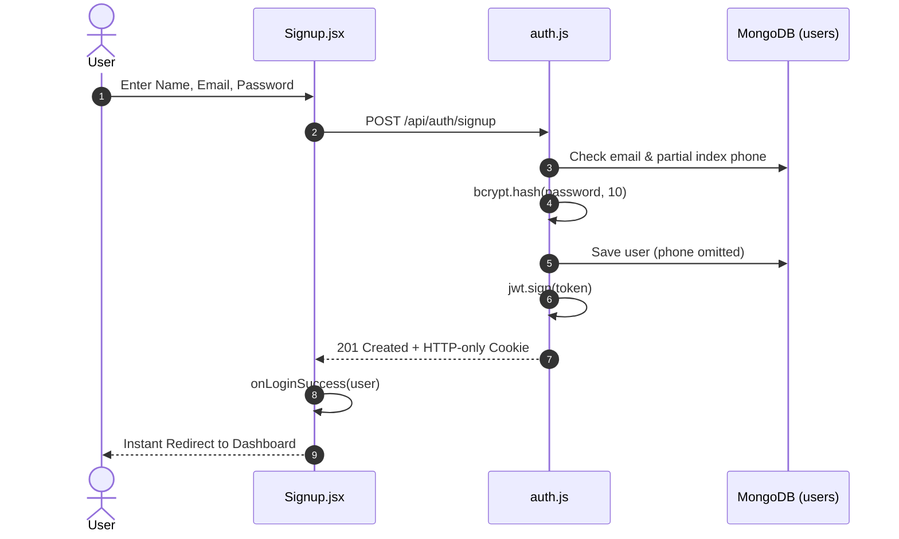

# AlgoRevis — System Design & Architecture Document

> **The Disciplined Curator for Data Structures & Algorithms** — An intelligent revision, spaced-repetition, and interactive practice platform designed for software engineers.

---

## Table of Contents

1. [Project Overview](#1-project-overview)
2. [High-Level Architecture](#2-high-level-architecture)
3. [Tech Stack](#3-tech-stack)
4. [Repository Structure](#4-repository-structure)
5. [Backend Design](#5-backend-design)
   - [Server Setup & Middleware](#51-server-setup--middleware)
   - [Database Models](#52-database-models)
   - [API Route Specifications](#53-api-route-specifications)
   - [Services & Background Workers](#54-services--background-workers)
6. [Frontend Design](#6-frontend-design)
   - [View Navigation & Deep Linking](#61-view-navigation--deep-linking)
   - [Component Architecture](#62-component-architecture)
7. [Core Feature Implementations](#7-core-feature-implementations)
   - [Authentication & Session Flow](#71-authentication--session-flow)
   - [Interactive Practice & Split-Screen Compiler](#72-interactive-practice--split-screen-compiler)
   - [Semantic AI Question Generation](#73-semantic-ai-question-generation)
   - [Multi-Platform Dual Link Aggregation](#74-multi-platform-dual-link-aggregation)
   - [Industry DSA Sheets Engine](#75-industry-dsa-sheets-engine)
   - [Timed DSA Mock Assessments](#76-timed-dsa-mock-assessments)
   - [Topics-Based Revision Mode](#77-topics-based-revision-mode)
   - [Notification & Delivery Scheduler](#78-notification--delivery-scheduler)
8. [Data Flow & System Diagrams](#8-data-flow--system-diagrams)
9. [Resolved Architecture Milestones & Future Roadmap](#9-resolved-architecture-milestones--future-roadmap)

---

## 1. Project Overview

**AlgoRevis** is an end-to-end DSA revision system that transforms passive problem saving into an active, retention-driven practice routine.

The platform provides:
- **Curated Problem Organization:** Group problems by pattern (e.g. *Sliding Window*, *Intervals*, *Dynamic Programming*).
- **Daily Challenge & Random Practice:** Dual-question workspace combining a user/curated problem (Question A) with a complementary AI-generated variant (Question B).
- **In-Browser Polyglot Compiler:** Run and validate JavaScript and Python solutions against automated test cases with execution telemetry.
- **Industry Standard DSA Sheets:** Integrated problem catalogs from **Striver's A2Z Sheet**, **CSES Problem Set**, and **Fraz's SDE Sheet** with direct one-click library imports.
- **Timed Mock Tests:** Real-time interview simulation environments with countdown timers and automated grading.
- **Multi-URL Problem Support:** Seamlessly allows saving duplicate problem names across platforms (e.g., LeetCode and GeeksforGeeks), displaying both links side-by-side in the compiler workspace.
- **Automated External Reminders:** Background cron scheduler sending daily revision tasks via email and WhatsApp.

---

## 2. High-Level Architecture

```
┌────────────────────────────────────────────────────────────────────────┐
│                           CLIENT LAYER (Browser)                       │
│                                                                        │
│   React 19 + Vite 8 + TailwindCSS v4                                   │
│   Views: Login │ Signup │ DashboardHome │ MyFolders                    │
│          AddNewProblemForm │ RevisionModeDashboard (Topics)             │
│          DailyChallengeView (Split Compiler) │ DsaSheetsView           │
│          MockTestsView                                                 │
└───────────────────────────────────┬────────────────────────────────────┘
                                    │ HTTP REST + Cookies (credentials: include)
                                    │ Port 5000
┌───────────────────────────────────▼────────────────────────────────────┐
│                         API & RUNTIME SERVER (Node.js)                 │
│                                                                        │
│   Express 5 REST APIs:                                                 │
│     ├── /api/auth       (bcrypt, JWT cookies, instant signup)          │
│     ├── /api/problems   (CRUD, folder batch operations)                │
│     ├── /api/challenges (daily queues, random picks, similar AI gen)   │
│     ├── /api/compiler   (sandboxed code execution: JS & Python)        │
│     └── /api/webhooks   (WhatsApp interactive responses)               │
│                                                                        │
│   Engines & Background Workers:                                        │
│     ├── aiService.js         (semantic category pattern detector)      │
│     ├── compilerService.js   (isolated test runner & stdout capture)   │
│     └── scheduler.js         (cron-based multi-channel reminder task)  │
└───────────────────────────────────┬────────────────────────────────────┘
                                    │ Mongoose 9 ODM
┌───────────────────────────────────▼────────────────────────────────────┐
│                       MONGODB ATLAS (Cloud Cluster)                    │
│                                                                        │
│   Collections:                                                         │
│     ├── users                (with partial unique index on phone)      │
│     ├── problems             (user-saved problem bank)                 │
│     ├── dailychallenges      (daily queue state & multi-links)         │
│     ├── aigeneratedquestions (cached semantic variants & test cases)   │
│     ├── practiceattempts     (compiler execution and submission logs)  │
│     └── pendingregistrations (session verification staging)            │
└────────────────────────────────────────────────────────────────────────┘
```

---

## 3. Tech Stack

| Component | Technology | Version | Purpose |
|---|---|---|---|
| **Frontend Framework** | React | 19.2.x | Modular SPA interface using functional components and custom hooks |
| **Client Bundler** | Vite | 8.x | Lightning-fast development server and optimized production packaging |
| **Styling** | TailwindCSS | v4.2.x | Tokenized Material 3 visual styling, signature gradients, and dark/light accents |
| **Backend Framework** | Express | 5.2.x | Asynchronous route handling and REST API middleware |
| **Database** | MongoDB Atlas / Mongoose | 9.x | Cloud document store with schema validation and partial indexing |
| **Authentication** | JWT + bcryptjs | 2.4.x | Salted password hashing (cost 10) and HTTP-only cookie session management |
| **Code Sandbox** | Node.js VM / Python CLI | Native | Isolated execution sandbox for user code and automated unit tests |
| **Email Service** | Resend API | 4.x | Transactional email delivery for daily revision problems |
| **Messaging Service** | Twilio API | 5.x | SMS and WhatsApp delivery for daily challenges |
| **Background Cron** | Node-cron / Timers | Native | Automated 60-second polling scheduler for scheduled notifications |

---

## 4. Repository Structure

```
algo_revis/
├── backend/
│   ├── models/
│   │   ├── User.js                 # Schema with bcrypt hashing & partial phone index
│   │   ├── Problem.js              # Problem model with URL-specific duplicate prevention
│   │   ├── DailyChallenge.js       # Daily practice session model with allLinks array
│   │   ├── AIGeneratedQuestion.js  # Generated variants with test cases & solutions
│   │   ├── PracticeAttempt.js      # Compiler submission & telemetry history
│   │   └── PendingRegistration.js  # Staging model for secure sessions
│   ├── routes/
│   │   ├── auth.js                 # Instant signup, login, session check, logout
│   │   ├── problems.js             # Problem CRUD, folder rename/delete
│   │   ├── challenges.js           # Random practice queue, AI question generation
│   │   ├── compiler.js             # Code execution & test case validation endpoint
│   │   └── webhooks.js             # WhatsApp inbound message webhooks
│   ├── services/
│   │   ├── aiService.js            # Semantic problem classifier & variant generator
│   │   ├── compilerService.js      # Isolated JS & Python test runner
│   │   ├── verificationService.js  # Multi-channel notification & OTP handlers
│   │   └── scheduler.js            # Automated cron scheduler
│   ├── middleware/
│   │   ├── auth.js                 # requireAuth, optionalAuth, JWT cookie helpers
│   │   └── rateLimiter.js          # In-memory IP/session rate limiter
│   ├── tests/
│   │   ├── randomPracticeIntegrationTests.js # E2E practice & compiler test suite
│   │   └── httpRouteTests.js       # Complete REST API route test suite
│   ├── server.js                   # Application bootstrap & MongoDB connection
│   └── package.json
│
└── frontend/
    ├── src/
    │   ├── api.js                  # Centralized client API wrapper with cookie credentials
    │   ├── App.jsx                 # View state router & session rehydration on mount
    │   ├── LoginPage.jsx           # Clean authentication sign-in form
    │   ├── Signup.jsx              # Zero-friction 3-field registration form
    │   ├── DashboardHome.jsx       # Analytics, streak indicator, recent folders
    │   ├── MyFolders.jsx           # Folders grid, problem review, daily challenge trigger
    │   ├── AddNewProblemForm.jsx   # Problem creation form with screenshot upload
    │   ├── RevisionModeDashboard.jsx # Revision queue & Topics pattern breakdown
    │   ├── DailyChallengeView.jsx  # Split-screen compiler & dual-question workspace
    │   ├── DsaSheetsView.jsx       # Striver, CSES, and Fraz DSA sheets view
    │   ├── MockTestsView.jsx       # Timed mock interview assessments view
    │   ├── index.css               # Global theme tokens and signature styling
    │   └── main.jsx                # React root mount
    └── package.json
```

---

## 5. Backend Design

### 5.1 Server Setup & Middleware
- **JSON & URL-Encoded Parsers:** 50MB payload limits to support base64 problem screenshot attachments.
- **Cookie Parser:** Parses secure HTTP-only session cookies.
- **CORS Config:** Configured with `credentials: true` for local client requests.
- **Rate Limiting:** Protects authentication and execution endpoints against abuse.

### 5.2 Database Models

#### `User` Model (`models/User.js`)
- `name`: String, required.
- `email`: String, required, unique, lowercase.
- `password`: Hashed using `bcrypt.genSalt(10)` in a pre-save hook.
- `phone`: String, optional (`default: undefined`).
- **Partial Index:**
  ```javascript
  UserSchema.index(
    { phone: 1 },
    {
      unique: true,
      partialFilterExpression: { phone: { $type: "string" } }
    }
  );
  ```
  *Ensures users who register without a phone never trigger MongoDB `null` duplicate key collisions (E11000).*
- `isEmailVerified` / `isPhoneVerified`: Boolean, defaults to `true`.
- `deliveryPreferences`: Delivery time, timezone, email and WhatsApp toggles.

#### `Problem` Model (`models/Problem.js`)
- `userName`: Problem owner reference.
- `name`: Title of the coding problem.
- `link`: Canonical problem URL.
- `pattern`: Folder categorization tag (e.g. *Two Pointers*, *Graph BFS*).
- `difficulty`: `Easy` | `Medium` | `Hard`.
- `notes`: Markdown approach notes.
- `imageBase64`: Screenshot data.
- **Duplicate Prevention Policy:** URL-specific check allows identical question names if their problem URLs differ, enabling users to store problem links from multiple platforms.

#### `DailyChallenge` Model (`models/DailyChallenge.js`)
- `userId`: Owner reference.
- `challengeDate`: Date formatted string (YYYY-MM-DD).
- `questionA`: Main problem details + `allLinks: [{ title, link, pattern, difficulty, problemId }]`.
- `questionB`: AI-generated variant question reference.
- `completedA` / `completedB`: Completion booleans.

#### `AIGeneratedQuestion` Model (`models/AIGeneratedQuestion.js`)
- `baseProblemName`: Originating problem name.
- `pattern`: Algorithmic archetype.
- `title`: Generated variant title.
- `description`, `constraints`, `examples`: Formatted problem specification.
- `testCases`: Array of `{ input, expectedOutput }` for unit tests.
- `referenceSolution`: Verified reference solution code for sandbox validation.

#### `PracticeAttempt` Model (`models/PracticeAttempt.js`)
- Logs code submissions: `userId`, `questionType` (`user` vs `ai`), `code`, `language`, `status` (`passed` | `failed`), `testCasesPassed`, `runtimeMs`.

---

## 6. Frontend Design

### 6.1 View Navigation & Deep Linking
The application utilizes a lightweight, reactive state router in `App.jsx` with session verification on load:

| View Identifier | Component | Description |
|---|---|---|
| `'login'` | `LoginPage.jsx` | User sign-in |
| `'signup'` | `Signup.jsx` | Zero-friction user registration |
| `'dashboard_home'` | `DashboardHome.jsx` | Primary analytics dashboard |
| `'folders'` | `MyFolders.jsx` | Folder grid & problem management |
| `'add_problem'` | `AddNewProblemForm.jsx` | Modal problem creation form |
| `'revision_dashboard'` | `RevisionModeDashboard.jsx` | Spaced repetition queue & Topics breakdown |
| `'daily_challenge'` | `DailyChallengeView.jsx` | Split-screen compiler & practice workspace |
| `'sheets'` | `DsaSheetsView.jsx` | Curated DSA sheets (Striver, CSES, Fraz) |
| `'mock_tests'` | `MockTestsView.jsx` | Timed mock interview assessments |

### 6.2 Session Rehydration
On application mount, `App.jsx` issues a request to `GET /api/auth/me`. If a valid HTTP-only cookie token is present, the session is silently rehydrated into `currentUser`, preventing unnecessary logouts upon page refresh.

---

## 7. Core Feature Implementations

### 7.1 Authentication & Session Flow
1. **Registration:** User enters Name, Email, and Password in `Signup.jsx`.
2. Form submits to `POST /api/auth/signup`.
3. Backend hashes password, sets `isEmailVerified: true`, saves the document (omitting `phone` to satisfy the partial index), signs a JWT token, and attaches it via HTTP-only cookie.
4. Response returns 201 with user object; client logs the user in immediately without any OTP verification bottleneck.

### 7.2 Interactive Practice & Split-Screen Compiler
1. User enters `DailyChallengeView.jsx` in `'random'` or `'daily'` mode.
2. Left pane displays Problem Statement, Examples, Constraints, and all platform links.
3. Right pane provides an interactive code editor supporting **JavaScript** and **Python**.
4. Clicking **Run Code** or **Submit Solution** posts code to `POST /api/compiler/run` or `POST /api/compiler/submit`.
5. Code executes in an isolated environment against test cases with output capture, duration profiling, and diagnostic diffs.

### 7.3 Semantic AI Question Generation
1. `detectProblemCategory(baseProblemName, pattern)` inspects problem titles for semantic keywords (e.g. "Two Sum", "Sliding Window", "Subarray", "Binary Search", "Dynamic Programming").
2. Generates a tailored problem variant matching the exact algorithmic paradigm with validated test cases and reference solutions.
3. Rotates variant selections to avoid repetitive suggestions.

### 7.4 Multi-Platform Dual Link Aggregation
1. When a problem has multiple entries with identical titles across different folders or URLs (e.g. LeetCode and GeeksforGeeks links), `challenges.js` invokes `resolveAllLinksForQuestion()`.
2. All unique URLs are packaged into `questionA.allLinks`.
3. `DailyChallengeView.jsx` displays badges for each external link side-by-side in both the problem header and compiler toolbar.

### 7.5 Industry DSA Sheets Engine (`DsaSheetsView`)
- Houses curated question catalogs:
  - **Striver's A2Z DSA Sheet**
  - **CSES Problem Set**
  - **Fraz's SDE Sheet**
- Features instant keyword search and difficulty filtering.
- Supports "+ Add to Revision" (auto-populating the user's folders) and "Practice in Compiler".

### 7.6 Timed DSA Mock Assessments (`MockTestsView`)
- Standardized mock tests simulating FAANG and top-tier technical interviews.
- Integrated countdown timers, question jumping, example I/O testing, and grading.

### 7.7 Topics-Based Revision Mode
- In `RevisionModeDashboard.jsx`, the **Topics** tab aggregates all saved problems by pattern/folder.
- Displays problem count, completion metrics, and difficulty tags (Easy/Medium/Hard).
- Expandable accordion cards provide instant links to solve online or practice within the compiler.

### 7.8 Notification & Delivery Scheduler
- `scheduler.js` runs in the background polling every 60 seconds.
- Dispatches automated revision reminders via **Resend Email API** and **Twilio SMS / WhatsApp**.
- Supports interactive WhatsApp webhooks (`/api/webhooks/whatsapp`) for mobile responses.

---

## 8. Data Flow & System Diagrams

### Overall Architecture & Navigation

```mermaid
flowchart TD
    subgraph Client [Frontend UI Layer]
        AuthView[Login / Signup]
        Dash[Dashboard Home]
        Folders[My Folders]
        Topics[Revision Topics]
        Workspace[Daily Challenge Compiler]
        Sheets[Curated DSA Sheets]
        Mock[Mock Tests]
    end

    subgraph Backend [Express API Server]
        AuthRoute[/api/auth]
        ProbRoute[/api/problems]
        ChalRoute[/api/challenges]
        CompRoute[/api/compiler]
        AIService[AI Category Engine]
        Scheduler[Cron Scheduler]
    end

    subgraph Database [MongoDB Atlas]
        UserCol[(users)]
        ProbCol[(problems)]
        ChalCol[(dailychallenges)]
        AICol[(aigeneratedquestions)]
        AttemptCol[(practiceattempts)]
    end

    AuthView --> AuthRoute
    Dash --> ProbRoute
    Folders --> ProbRoute
    Topics --> ProbRoute
    Workspace --> ChalRoute
    Workspace --> CompRoute
    Sheets --> ProbRoute
    Mock --> CompRoute

    ChalRoute --> AIService
    AuthRoute --> UserCol
    ProbRoute --> ProbCol
    ChalRoute --> ChalCol
    AIService --> AICol
    CompRoute --> AttemptCol
    Scheduler --> ChalCol
```

### Authentication Flow (Zero-Friction Registration)



---

## 9. Resolved Architecture Milestones & Future Roadmap

### ✅ Completed & Resolved
- [x] **Secure Password Hashing:** Salted `bcryptjs` encryption fully implemented.
- [x] **Persistent Sessions:** JWT signed tokens in HTTP-only cookies with silent `/api/auth/me` restore on page reload.
- [x] **Zero-Friction Signup:** No OTP blockers; users register and access the workspace immediately.
- [x] **Collision-Free Phone Indexing:** MongoDB `partialFilterExpression` prevents `null` duplicate key collisions (E11000).
- [x] **In-Browser Polyglot Compiler:** Sandboxed execution for JavaScript and Python with unit test validation.
- [x] **Semantic AI Question Engine:** Pattern-aware variant generation avoiding repetitive placeholders.
- [x] **Multi-Platform URL Support:** Allows identical question names across platforms and displays dual links side-by-side.
- [x] **Industry DSA Sheets:** Striver's A2Z Sheet, CSES Problem Set, and Fraz's SDE Sheet integrated with one-click revision imports.
- [x] **Timed Mock Tests:** Interview sprint environments with active timers and automated test runner.
- [x] **Interactive Topics View:** Full problem aggregation by algorithmic pattern in Revision Mode.
- [x] **Automated Scheduler:** Multi-channel daily revision reminders via Resend and Twilio.

### 🔮 Future Roadmap
- [ ] Add Monaco Editor / CodeMirror enhanced syntax highlighting and auto-completion.
- [ ] Implement spaced repetition interval algorithms (e.g. SuperMemo SM-2) for review scheduling.
- [ ] Integrate C++ and Java execution environments in the compiler sandbox.
