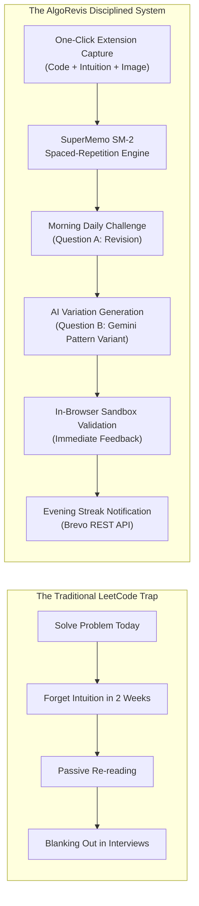
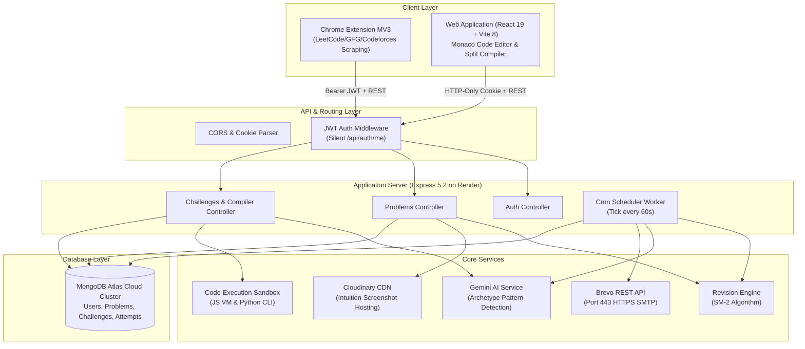

# 00. Project Home — AlgoRevis

> 💡 **Welcome to AlgoRevis Documentation**: This workspace contains the authoritative technical architecture, schema specifications, and workflow documentation for **AlgoRevis**.

---

## 📌 Project Overview

| Property | Value |
|---|---|
| **Project Name** | **AlgoRevis** |
| **Tagline** | The Disciplined Curator for Algorithmic Mastery |
| **Current Version** | `1.0.0-production` |
| **Live Web App** | [https://algorevis-app.onrender.com](https://algorevis-app.onrender.com) |
| **Live Backend API** | [https://algorevis-backend.onrender.com](https://algorevis-backend.onrender.com) |
| **Git Repository** | [GitHub Repository](https://github.com/harsh13satyam/ALGO_REVIS_.git) |
| **License** | MIT License |
| **Primary Architecture** | Decoupled Client-Server (React 19 + Node/Express 5 + MongoDB Atlas + Chrome Extension MV3) |

---

## 🎯 The Problem & The Solution

### The Problem
Engineers preparing for top-tier software engineering interviews suffer from the **"Leaky Bucket Problem"**:
- You solve 200+ problems, but 3 weeks later, you cannot recall the invariant for sliding window or the base cases for dynamic programming.
- Problem solutions are scattered across platforms (LeetCode, GeeksforGeeks, Codeforces), personal notebooks, and GitHub gists with zero systematic recall mechanism.
- Reviewing solutions passively (re-reading code) gives an illusion of competence; only **active recall** under simulated test conditions creates durable neural pathways.

### The Solution: AlgoRevis
**AlgoRevis** transforms DSA preparation into a disciplined, automated, spaced-repetition habit:
1. **Seamless Capture**: A Chrome Extension (Manifest V3) scrapes problem statements, constraints, submitted code, and intuition notes from LeetCode, GeeksforGeeks, and Codeforces with one click.
2. **Dual-Question Challenge**: Every morning, the engine selects **Question A** (a past problem scheduled by SM-2 spaced repetition) and generates **Question B** (a contextually calibrated AI variant created by Google Gemini).
3. **Integrated Execution**: A split-screen Monaco code editor allows running JavaScript and Python code against public and hidden test cases in an isolated execution sandbox.
4. **Streak Protection**: An automated dual-reminder system (09:00 AM problem release + 07:00 PM streak protection alert) delivered via Brevo HTTPS REST API keeps users disciplined every day.

---

## 🏗️ High-Level System Architecture

---

## 📑 Fast Navigation to All Documentation Pages

- **[01. Executive Summary](./01_executive_summary.md)**: Vision, differentiators, and impact.
- **[02. Requirements and Features](./02_requirements_and_features.md)**: Verified functional & non-functional requirements.
- **[03. System Architecture](./03_system_architecture.md)**: Comprehensive architectural breakdown.
- **[04. Data Flow and Process Diagrams](./04_data_flow_and_process_diagrams.md)**: Sequence diagrams for auth, scheduling, code execution.
- **[05. Database Design](./05_database_design.md)**: MongoDB schemas, ERDs, and index strategies.
- **[06. API Documentation](./06_api_documentation.md)**: Exhaustive route specifications and payloads.
- **[07. Authentication and Security](./07_authentication_and_security.md)**: Cryptographic password hashing and sandbox isolation.
- **[08. Installation and Local Development](./08_installation_and_local_development.md)**: Step-by-step developer onboarding.
- **[09. Internal Codebase Documentation](./09_internal_codebase_documentation.md)**: File-by-file directory reference.
- **[10. Testing and Quality Assurance](./10_testing_and_quality_assurance.md)**: Test suites, assertions, and coverage gates.
- **[11. Deployment and DevOps](./11_deployment_and_devops.md)**: Cloud hosting, Render build pipelines, and health checks.
- **[12. Troubleshooting and FAQ](./12_troubleshooting_and_faq.md)**: Known edge cases, recovery strategies, and error matrices.
- **[13. Roadmap and Future Improvements](./13_roadmap_and_future_improvements.md)**: Completed milestones and engineering backlog.
- **[14. Contribution Guidelines](./14_contribution_guidelines.md)**: Code standards, branching, and pull requests.
- **[15. Glossary and References](./15_glossary_and_references.md)**: Definitions, academic references, and tool docs.
- **[Notion Import Guide](./NOTION_IMPORT_GUIDE.md)**: Step-by-step guide to import into Notion.
