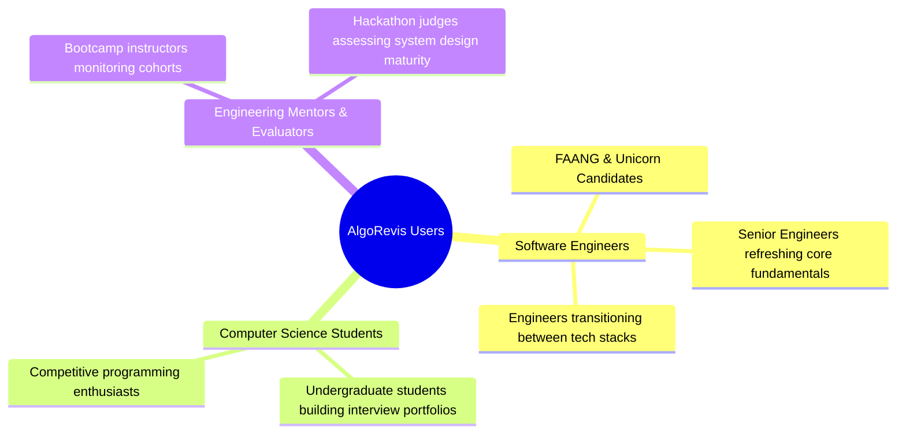

# 01. Executive Summary — AlgoRevis

> 🎯 **Executive Brief**: AlgoRevis is an engineering productivity platform designed to eliminate the forgetting curve in technical interview preparation through automated spaced repetition, AI-generated variant practice, and multi-platform capture.

---

## 1. Vision & Strategic Goals

The modern software engineering hiring market heavily relies on technical algorithmic interviews. Candidates spend hundreds of hours across competitive programming platforms like LeetCode, Codeforces, and GeeksforGeeks. However, traditional preparation is fundamentally flawed:

1. **Memory Decay**: Human memory follows the Ebbinghaus Forgetting Curve; up to 75% of algorithmic insights are lost within six days without structured active recall.
2. **Fragmented Learning**: Solutions and personal intuitions are trapped across browser tabs, scratchpads, and platform histories without a single source of truth.
3. **Passive Review Failure**: Rereading past code yields familiarity rather than recall. Candidates fail when interviewers introduce slight variations to well-known problems.

**AlgoRevis** establishes a closed-loop system: **Capture → Schedule → Active Recall → AI Stress Testing → Retention Metrics**.

---

## 2. Key Differentiators & Competitive Advantage

| Feature Dimension | Traditional Practice (LeetCode/Notion) | AlgoRevis Platform |
|---|---|---|
| **Capture Workflow** | Copy-pasting code, manually formatting markdown tables | **Chrome Extension MV3**: One-click extraction of problem statement, solution, approach, and screenshot directly from LeetCode, GFG, or Codeforces |
| **Revision Strategy** | Ad-hoc ("I will revise dynamic programming this weekend") | **Automated SM-2 Spaced Repetition**: Calculates optimal review dates based on recall difficulty and user mastery |
| **Variation Testing** | Memorizing specific test cases for a single problem ID | **Context-Aware AI Generation**: Dynamically creates a new, complementary problem testing the identical underlying pattern |
| **Execution Environment** | Opening external IDE or paying for platform premium features | **Integrated Dual-Pane Sandbox**: In-browser compiler for JS/Python with automated test evaluation and real-time pass/fail diffs |
| **Accountability** | Self-discipline only | **Automated Dual Notification Pipeline**: Brevo HTTPS REST API delivers morning challenge release + evening streak protection alert |
| **Image Hosting** | Broken local file paths or costly manual uploads | **Cloudinary CDN Integration**: Direct clipboard paste (`Ctrl+V`) and automated upload of handwritten diagrams |

---

## 3. Target Audience & Personas

### Persona A: The FAANG Candidate (Priya, Senior SWE)
- **Pain Point**: Solved 400 problems 6 months ago, but feels completely unprepared when asked to implement Dijkstra or topological sort from scratch.
- **Solution**: AlgoRevis queues exactly the problems that are about to fade from long-term memory, requiring only 20 minutes a day to maintain peak interview readiness.

### Persona B: The Active Student (Rohan, CS Undergrad)
- **Pain Point**: Struggles with pattern recognition; freezes when a problem does not match LeetCode's exact phrasing.
- **Solution**: Question B (AI variant) forces Rohan to recognize the pattern (e.g., Sliding Window) in an entirely new context.

---

## 4. Current Implementation Status

AlgoRevis is not a conceptual mockup; it is a fully functioning, deployed production platform:

- ✅ **Core Web Application**: Live on Render ([https://algorevis-app.onrender.com](https://algorevis-app.onrender.com)).
- ✅ **Backend REST API**: Live on Render ([https://algorevis-backend.onrender.com](https://algorevis-backend.onrender.com)).
- ✅ **Chrome Extension**: Manifest V3 extension with native DOM scrapers for LeetCode, GeeksforGeeks, and Codeforces.
- ✅ **Database**: MongoDB Atlas cloud cluster with production partial indexing and automated replication.
- ✅ **AI Engine**: Google Gemini API integration with timeout fallbacks and curated algorithmic archetype libraries.
- ✅ **Notification Pipeline**: Brevo HTTPS REST API configured on Port 443 with live dual-notification scheduling.
