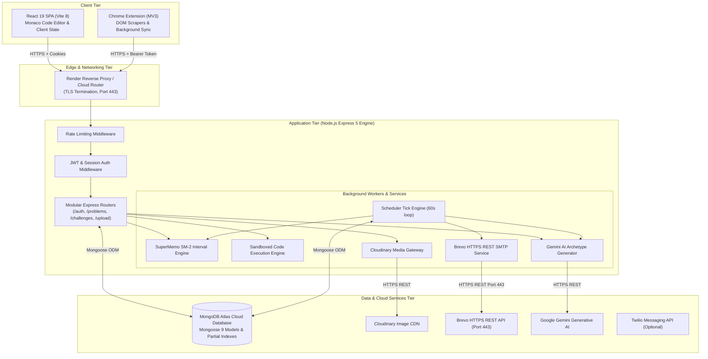
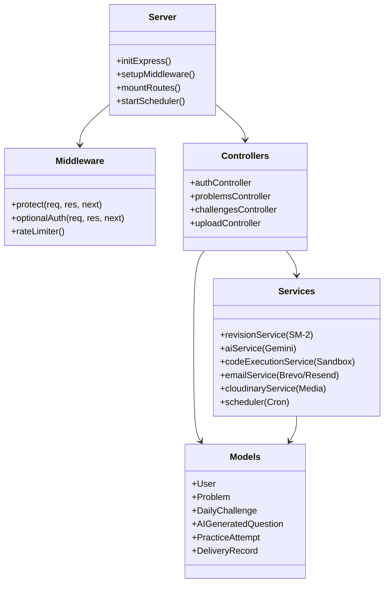
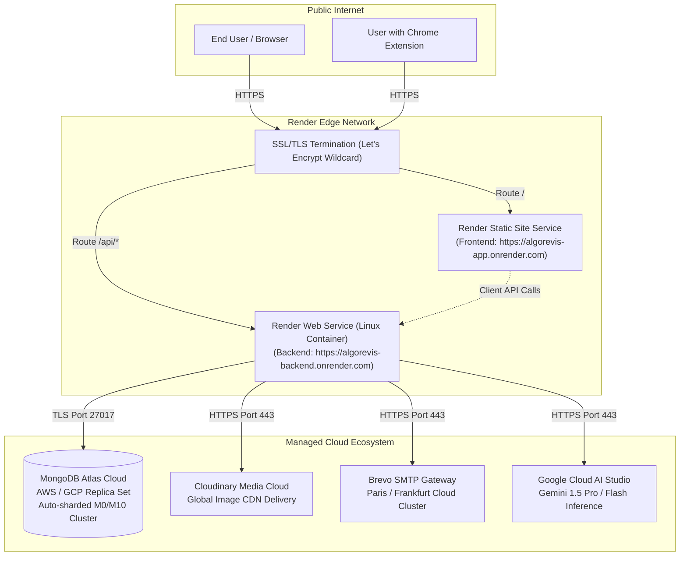

# 03. System Architecture — AlgoRevis

> 🏛️ **System Architecture Specification**: This document details the layered software architecture, internal component interactions, cloud infrastructure, and deployment topology of AlgoRevis.

---

## 1. High-Level Architectural Flow

AlgoRevis follows a **decoupled Client-Server Architecture** utilizing an Express 5 REST API backend, a reactive React 19 Single-Page Application (SPA), an independent Chrome Extension (Manifest V3), and managed cloud infrastructure:

---

## 2. Component Architecture Breakdown

The backend codebase is structured into cohesive, single-responsibility layers:

### Module Responsibilities

1. **`server.js` (Entry Point)**:
   - Configures Express 5, CORS with strict allowed origins, cookie parser, and JSON body parsing with a 50MB payload limit (allowing base64 problem screenshot transfers).
   - Establishes resilient MongoDB Atlas connection with automatic reconnect handlers.
   - Boots background scheduler on startup and mounts modular routes.

2. **Middleware Layer (`backend/middleware/auth.js`)**:
   - `protect`: Extracts JWT token from either HTTP-only cookie (`token`) or `Authorization: Bearer <token>` header (allowing identical authentication for both browser client and Chrome Extension). Decodes token, validates payload, and attaches `req.user`.
   - `optionalAuth`: Soft authentication permitting guest interactions where applicable while decorating authenticated requests.

3. **Service Layer (`backend/services/`)**:
   - **`revisionService.js`**: Pure mathematical implementation of SuperMemo SM-2. Calculates next review interval, new repetition count, and updated ease factor based on performance grades (0–5).
   - **`aiService.js`**: Semantic pattern extractor. Ingests problem details, detects underlying algorithmic archetype (e.g. *Two Pointers & Hash Map*, *Sliding Window*, *Monotonic Stack*), constructs temperature-controlled prompts for Google Gemini, validates generated test cases, and caches results. Implements robust timeout fallbacks to internal curated question banks.
   - **`codeExecutionService.js`**: Multi-language code evaluation runner. Executes JavaScript in a Node.js VM context and Python via isolated child processes. Enforces 5,000ms timeouts, injects automated test-case runner harnesses, and captures runtime metrics.
   - **`emailService.js`**: Multi-tier email delivery pipeline. Prioritizes Brevo HTTPS REST API on Port 443 (eliminating cloud firewall blocks on SMTP ports 25/465/587), fallback to Resend API, and local mock logging.
   - **`cloudinaryService.js`**: Base64 data-URI and buffer media uploader into Cloudinary's global CDN with signed delivery URLs.

---

## 3. Deployment Architecture & Infrastructure

The production application is continuously deployed via Render cloud infrastructure:

---

## 4. Technology Stack Architecture Table

| Technology | Layer | Project Location | Purpose & Architecture Rationale |
|---|---|---|---|
| **React 19** | Client Framework | `frontend/src/` | Component-based reactive UI; seamless integration with Monaco editor and state hooks |
| **Vite 8** | Client Bundler | `frontend/vite.config.js` | Fast HMR (Hot Module Replacement) and optimized tree-shaken static production bundles |
| **TailwindCSS v4** | CSS Design System | `frontend/src/index.css` | High-performance CSS compiler with zero-runtime overhead and tokenized Material 3 palettes |
| **Monaco Editor** | Code Component | `DailyChallengeView.jsx` | VS Code-grade code editor with syntax highlighting, indentation, and keybindings in browser |
| **Node.js (v20+)** | Runtime Engine | `backend/` | High-throughput asynchronous event-driven JavaScript engine running Express backend |
| **Express 5.2** | API Framework | `backend/server.js` | Industry-standard REST routing framework with native promise rejection handling |
| **MongoDB Atlas** | Database | Cloud Cluster | Schemaless document database accommodating varied DSA test cases, AST codes, and nested metadata |
| **Mongoose 9** | ODM Library | `backend/models/` | Strongly-typed schemas, automatic timestamps, pre-save hashing hooks, and partial indexing |
| **JWT (jsonwebtoken)** | Authentication | `backend/middleware/auth.js` | Stateless session tokens enabling cross-domain authentication across Web SPA and Chrome Extension |
| **bcryptjs** | Cryptography | `backend/models/User.js` | One-way salted credential hashing with work factor 10 to resist rainbow table attacks |
| **Brevo REST API** | Email Pipeline | `backend/services/emailService.js` | HTTPS Port 443 transactional email engine delivering morning and evening streak notifications |
| **Google Gemini API** | Generative AI | `backend/services/aiService.js` | Contextual AI generation synthesizing realistic, testable Question B algorithmic variants |
| **Cloudinary** | Image CDN | `backend/services/cloudinaryService.js` | Cloud media storage handling screenshot uploads and clipboard intuition graphics |
| **Chrome Manifest V3** | Browser Extension | `algorevis-extension/` | Modern extension standard with declarative network rules, background service workers, and DOM adapters |
