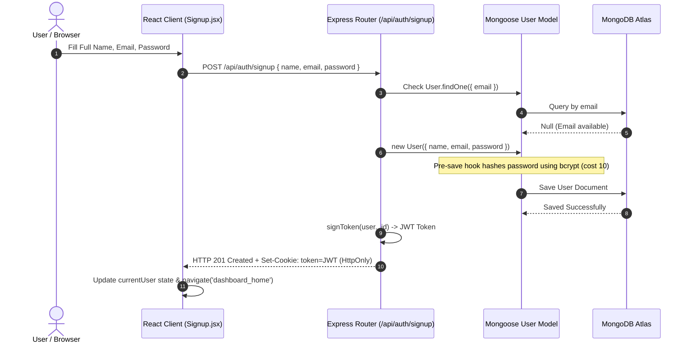
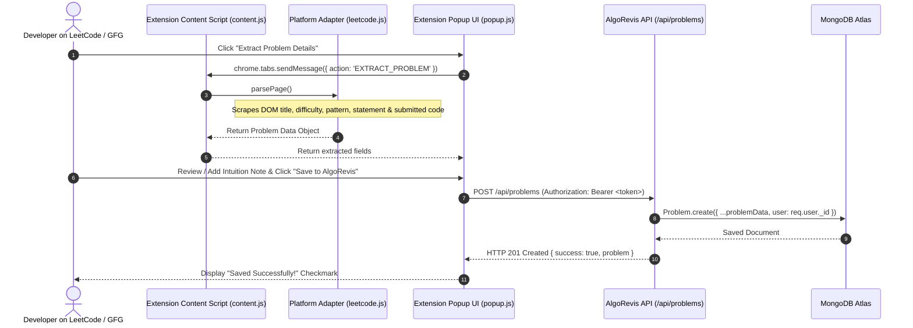
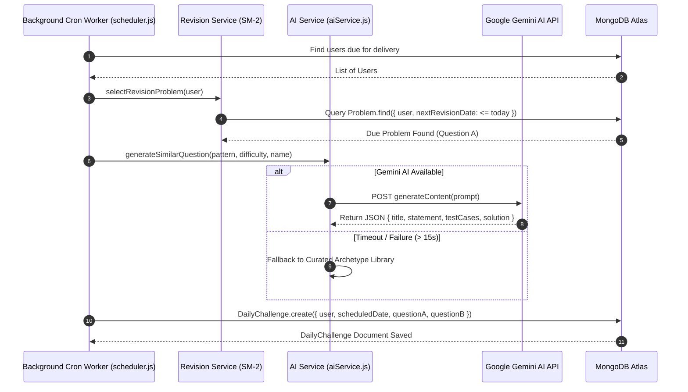
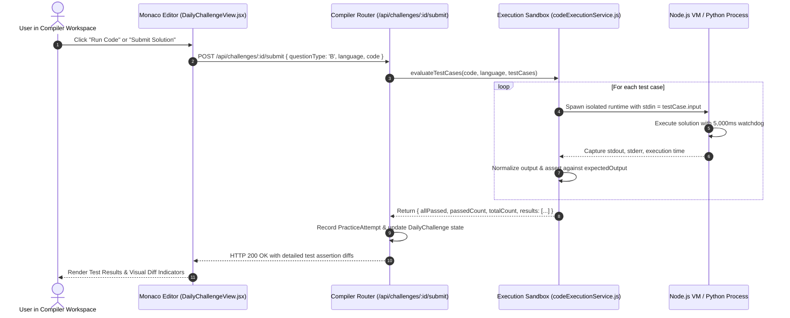
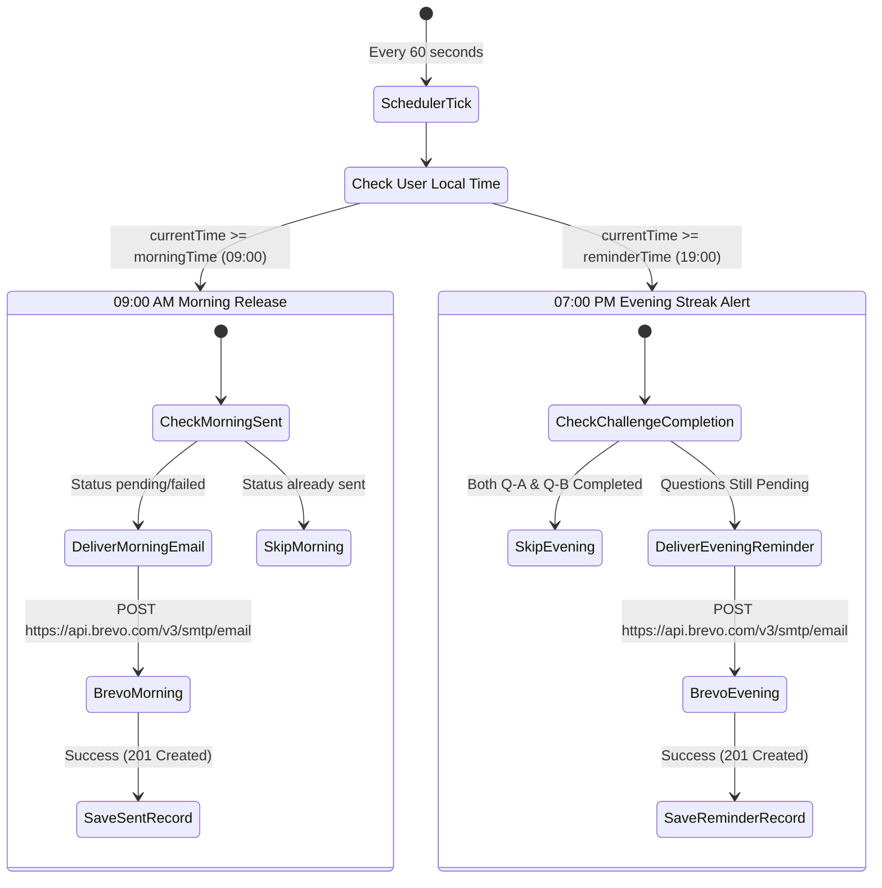

# 04. Data Flow and Process Diagrams — AlgoRevis

> 🔄 **Workflow & Process Specifications**: This document illustrates the core execution paths, temporal sequences, and data transformations across the AlgoRevis platform using detailed Mermaid sequence and state diagrams.

---

## 1. User Registration & Zero-Friction Authentication Flow

AlgoRevis offers instant signup without mandatory OTP bottlenecks, while maintaining optional phone/email verification:

---

## 2. Chrome Extension Scraping & One-Click Sync Flow

---

## 3. Daily Challenge Generation (SM-2 Spaced Repetition + Gemini AI)

---

## 4. In-Browser Polyglot Code Sandbox Execution Flow

---

## 5. Dual-Notification Delivery Pipeline (2 Emails Per Day)

AlgoRevis enforces a strict **2-email-per-day rhythm** to guarantee that daily practice habits are formed and preserved:

