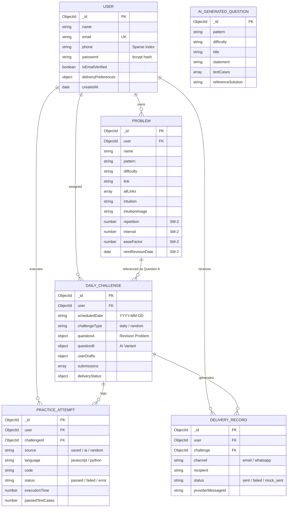

# 05. Database Design & Schemas — AlgoRevis

> 🗄️ **Data Architecture Specification**: This document details the MongoDB Atlas document models, Mongoose 9 schemas, partial indexes, relational references, and access patterns powering AlgoRevis.

---

## 1. Entity Relationship Diagram (ERD)

Although MongoDB is a document-oriented database, AlgoRevis enforces strong relational references and compound constraints across its core collections:



---

## 2. Verified Collections & Schemas

### 1. `users` Collection (`backend/models/User.js`)
Stores authenticated user accounts, password hashes, and notification preferences.

| Field Name | Type | Constraints / Defaults | Description |
|---|---|---|---|
| `_id` | `ObjectId` | Primary Key, Auto | Unique user identifier |
| `name` | `String` | Required, Trim (2–60 chars) | Full user display name |
| `email` | `String` | Required, Unique, Lowercase | Unique login email |
| `phone` | `String` | Optional, Sparse Index | Mobile phone number |
| `password` | `String` | Required, Min length 6 | bcrypt-hashed password (cost factor 10) |
| `isEmailVerified`| `Boolean` | Default: `true` | Email verification flag |
| `emailConsent` | `Boolean` | Default: `true` | Explicit consent for email notifications |
| `deliveryPreferences.time` | `String` | Default: `'09:00'` | 24-hr time for Morning Challenge Release |
| `deliveryPreferences.reminderTime` | `String` | Default: `'19:00'` | 24-hr time for Evening Streak Alert |
| `deliveryPreferences.timezone` | `String` | Default: `'UTC'` | IANA timezone string (e.g. `'Asia/Kolkata'`) |
| `deliveryPreferences.emailEnabled` | `Boolean` | Default: `true` | Master switch for challenge emails |
| `deliveryPreferences.reminderEmailEnabled` | `Boolean` | Default: `true` | Master switch for evening reminder emails |

> 🔒 **Critical Architecture Decision — Collision-Free Phone Index**:
> In earlier versions, a standard unique index on `phone` caused MongoDB `E11000` duplicate key errors when multiple users signed up without a phone number (`phone: null`). AlgoRevis resolves this via a **Partial Filter Expression Index**:
> ```javascript
> UserSchema.index({ phone: 1 }, {
>   unique: true,
>   partialFilterExpression: { phone: { $type: "string" } }
> });
> ```

---

### 2. `problems` Collection (`backend/models/Problem.js`)
Stores user-curated DSA problems, Spaced Repetition (SM-2) metrics, intuition attachments, and multi-platform links.

| Field Name | Type | Defaults | Purpose |
|---|---|---|---|
| `user` | `ObjectId` | Required, Ref: `'User'` | Owner of the problem |
| `name` | `String` | Required | Problem title (e.g. "Two Sum") |
| `pattern` | `String` | Default: `'General'` | Algorithmic archetype (e.g. "Sliding Window") |
| `difficulty` | `String` | Enum: `['Easy', 'Medium', 'Hard']` | Complexity level |
| `link` | `String` | Default: `''` | Primary problem URL |
| `allLinks` | `Array[{ title, link, pattern, difficulty }]` | Default: `[]` | Multi-URL dual links (LeetCode + GFG) |
| `intuition` | `String` | Default: `''` | User's algorithmic intuition and invariant |
| `intuitionImage` | `String` | Default: `''` | Cloudinary CDN URL or base64 image data |
| `repetition` | `Number` | Default: `0` | SuperMemo SM-2 repetition counter |
| `interval` | `Number` | Default: `1` | SuperMemo SM-2 interval in days |
| `easeFactor` | `Number` | Default: `2.5` | SuperMemo SM-2 difficulty multiplier (min 1.3) |
| `nextRevisionDate` | `Date` | Default: `Date.now` | Next scheduled revision date |

---

### 3. `dailychallenges` Collection (`backend/models/DailyChallenge.js`)
Tracks daily challenges, random practice sessions, user code drafts, and delivery statuses.

| Field Name | Type | Purpose |
|---|---|---|
| `user` | `ObjectId` | Associated user |
| `scheduledDate` | `String` | Date string `'YYYY-MM-DD'` or `'practice_<timestamp>_<id>'` |
| `challengeType` | `String` | Enum: `['daily', 'random_practice']` |
| `questionA` | `Subdocument` | Revision problem details, notes, links, completion status |
| `questionB` | `Subdocument` | AI-generated problem, statement, testCases, referenceSolution |
| `userDrafts` | `Subdocument` | Real-time code autosave for Question A and Question B |
| `submissions` | `Array` | Log of test case submissions with passed/failed counts |
| `deliveryStatus.email` | `Object` | `{ status: 'sent', sentAt, messageId, error }` |
| `deliveryStatus.reminderEmail` | `Object` | `{ status: 'sent', sentAt, messageId, error }` |

> 🔑 **Compound Index**:
> ```javascript
> DailyChallengeSchema.index({ user: 1, scheduledDate: 1 }, { unique: true });
> ```
> Guarantees exactly one daily challenge per user per day, preventing concurrent race conditions during scheduler ticks.

---

### 4. `aigeneratedquestions` Collection (`backend/models/AIGeneratedQuestion.js`)
Caches successfully synthesized AI problems to eliminate redundant Gemini API quota usage.

### 5. `practiceattempts` Collection (`backend/models/PracticeAttempt.js`)
Detailed telemetry logs for every code run and submission in the browser compiler.

### 6. `deliveryrecords` Collection (`backend/models/DeliveryRecord.js`)
Audit log tracking every email, SMS, and webhook notification attempt, status, and third-party message ID.
