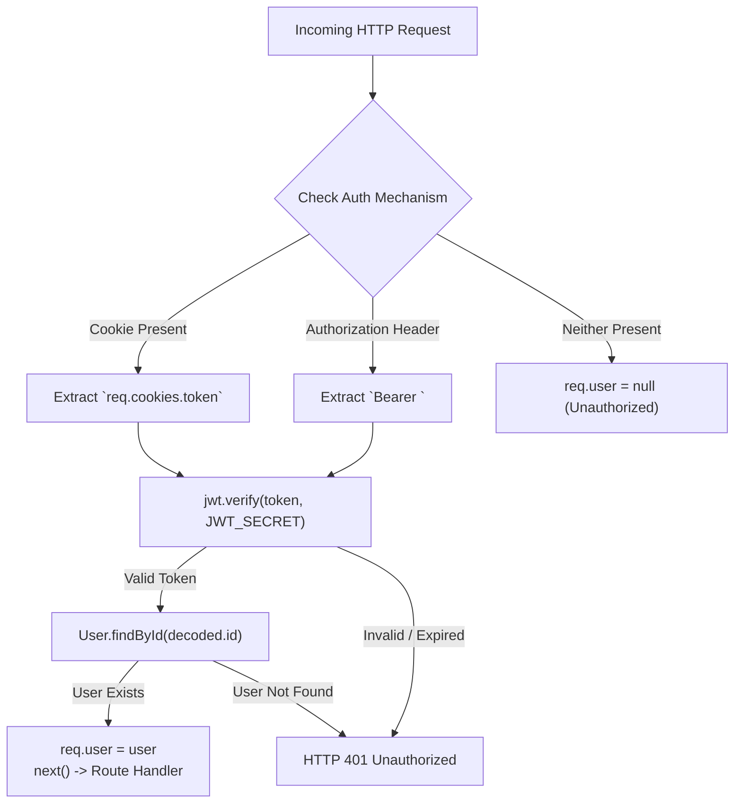
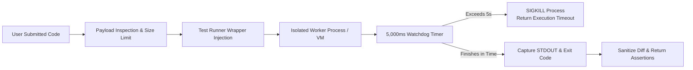

# 07. Authentication and Security — AlgoRevis

> 🔒 **Security Architecture Specification**: This document details the cryptographic safeguards, session tokens, sandbox execution jails, and data protection strategies implemented across AlgoRevis.

---

## 1. Authentication Architecture

AlgoRevis employs a **Hybrid Authentication Model** that seamlessly handles both browser Single-Page Applications (SPAs) and browser extensions (Chrome MV3):



---

## 2. Password Cryptography

All user credentials undergo one-way salted encryption prior to persistence:

- **Algorithm**: `bcryptjs`
- **Work Factor (Cost)**: `10` salt rounds (recommended balance between brute-force resistance and server throughput).
- **Mongoose Pre-Save Guard**:
  ```javascript
  UserSchema.pre('save', async function() {
    if (!this.isModified('password')) return;
    // Prevent accidental re-hashing if password is already a bcrypt hash
    if (typeof this.password === 'string' && /^\$2[abyx]\$\d+\$/.test(this.password)) {
      return;
    }
    const salt = await bcrypt.genSalt(10);
    this.password = await bcrypt.hash(this.password, salt);
  });
  ```
- **Password Comparison**: `bcrypt.compare(candidatePassword, storedHash)` prevents timing attacks.

---

## 3. Session & Token Management

- **Format**: JSON Web Token (JWT) with standard HMAC-SHA256 signature (`HS256`).
- **Payload Claims**:
  ```json
  {
    "id": "671bb0e1816e04d49a212345",
    "iat": 1730000000,
    "exp": 1732592000
  }
  ```
- **Cookie Security Flags**:
  - `httpOnly: true`: Prevents client-side scripts from reading the token, neutralizing Cross-Site Scripting (XSS) token exfiltration.
  - `secure: process.env.NODE_ENV === 'production'`: Ensures cookies are only transmitted over TLS (HTTPS).
  - `sameSite: 'lax'`: Protects against Cross-Site Request Forgery (CSRF).
  - `maxAge: 30 * 24 * 60 * 60 * 1000` (30-day persistent session).

---

## 4. Code Execution Sandbox Security

Executing arbitrary user-submitted code presents severe remote code execution (RCE) and denial-of-service (DoS) risks. AlgoRevis enforces rigorous execution barriers:



### Safety Controls
1. **Execution Watchdog**: A strict **5,000 millisecond timeout** terminates runaway loops (`while(true)`) or excessive recursion.
2. **Standard I/O Redirection**: Standard output and error streams are captured into memory buffers with character caps (10,000 chars) to prevent buffer overflow attacks via infinite logging (`console.log`).
3. **Execution Context**: Code is evaluated in restricted scopes without access to the host Express application context, environment variables, or database handles.

---

## 5. Network Security & Data Protection

| Security Vector | Implementation Detail | Location in Codebase |
|---|---|---|
| **CORS Policy** | Whitelist strictly enforcing allowed domains: `https://algorevis-app.onrender.com`, `http://localhost:5173`, `chrome-extension://*` | `backend/server.js` |
| **Payload Limiting** | Body parser capped at 50MB (allowing base64 problem screenshot transfers while blocking memory flooding) | `backend/server.js` |
| **Data Sanitation** | All user responses run through `toSafeObject()` on the User model, stripping `password`, `emailOTP`, and `phoneOTP` | `backend/models/User.js` |
| **Rate Limiting** | Optional request throttling on auth endpoints to prevent brute-force attacks | `backend/server.js` |
| **Secrets Management** | Zero credentials committed in repository; all API keys and database strings loaded via `process.env` | `backend/.env` |
