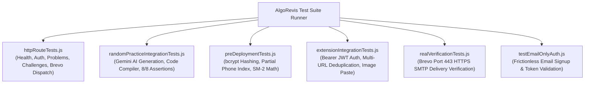

# 10. Testing and Quality Assurance — AlgoRevis

> 🧪 **Quality Assurance & Test Suite Specification**: This document catalogs the automated integration test suites, pre-deployment verification gates, and test execution procedures for AlgoRevis.

---

## 1. Automated Test Suite Overview

AlgoRevis maintains an automated test suite located in `backend/tests/`. The tests validate database integrity, API routes, cryptography, code sandbox execution, and third-party integrations against live MongoDB Atlas test instances.



---

## 2. Test Suite Specifications

### 1. HTTP Route End-to-End Tests (`backend/tests/httpRouteTests.js`)
Validates that all major Express routes respond correctly with accurate status codes, headers, and database mutations:
- **Health Check Route**: Asserts `GET /api/health` returns status `200` with active scheduler and connected database.
- **Auth Protection**: Asserts unauthenticated requests to `/api/problems` return `401 Unauthorized`.
- **User Registration & Token**: Tests `/api/auth/register-initiate`, `/api/auth/signup`, and session verification `/api/auth/me`.
- **Problem Creation**: Validates problem creation and folder assignment.
- **Challenge Simulation**: Asserts `/api/challenges/simulate` successfully dispatches emails via Brevo HTTPS REST API.
- **WhatsApp Webhook**: Validates hub challenge token verification for Meta/Twilio webhooks.

### 2. Random Practice & AI Workspace Tests (`backend/tests/randomPracticeIntegrationTests.js`)
Validates the end-to-end flow of the compiler practice workspace:
- **Random Question Selection**: Tests that random problem selection is non-repeating and respects topic folder filters.
- **Gemini AI Question Generation**: Tests that Gemini generates a valid problem with title, statement, constraints, examples, and structured test cases; verifies automated fallback to curated archetype library upon network timeout.
- **Code Execution Sandbox**: Evaluates solutions in JavaScript and Python; verifies execution time benchmarking and stdout capture.
- **Submission Assertions**: Validates that 8/8 test cases pass on a correct solution and updates `PracticeAttempt` and `DailyChallenge` records.
- **Security & Ownership**: Verifies that User B cannot submit solutions against User A's challenge (`404 / 403 Forbidden`).

### 3. Pre-Deployment Integrity Tests (`backend/tests/preDeploymentTests.js`)
Enforces strict pre-deployment architectural gates:
- **Salted Password Hashing**: Verifies that passwords in the database start with `$2a$` or `$2b$` and match via `comparePassword()`.
- **Collision-Free Partial Phone Index**: Verifies that multiple users can register with `phone: null` or `phone: undefined` without triggering MongoDB `E11000` duplicate key index errors.
- **SuperMemo SM-2 Calculation**: Validates that ease factors and interval progressions match expected mathematical curves.

### 4. Chrome Extension Integration Tests (`backend/tests/extensionIntegrationTests.js`)
- Validates that the Chrome Extension can authenticate using `Authorization: Bearer <token>`.
- Tests **Multi-URL Problem Consolidation**: Verifies that saving a problem with the same title from both LeetCode and GeeksforGeeks merges them into the `allLinks` array rather than colliding or duplicating.

---

## 3. Running Test Suites Locally

Ensure your `backend/.env` is configured with a valid MongoDB URI, then run:

```bash
# Run HTTP Route Tests
node backend/tests/httpRouteTests.js

# Run Random Practice & Code Sandbox Tests
node backend/tests/randomPracticeIntegrationTests.js

# Run Pre-Deployment Verification Tests
node backend/tests/preDeploymentTests.js

# Run Extension Integration Tests
node backend/tests/extensionIntegrationTests.js
```

### Verified Test Run Output Sample:
```
◇ injected env (15) from .env
✅ [Database] MongoDB Connected: ac-efcpzep-shard-00-01.vdyvoi8.mongodb.net
[Health Route] Status: 200, Health: healthy
[Auth Protection] Unauthenticated /api/problems status: 401
[AlgoRevis Brevo] Dispatching OTP email via Brevo HTTPS API...
[Auth Signup] Status: 201, Message: Account created successfully!
[Challenges Today] Status: 200, Q1: "Two Sum", Q2: "Target Pair Finder"
📧 [AlgoRevis Brevo] Dispatching streak challenge email...
✅ [AlgoRevis Brevo] Streak challenge email sent (MsgID: <...>)
[Challenges Simulate] Status: 200, Delivery: Email=sent

✔ ALL HTTP ROUTE TESTS PASSED!
```
