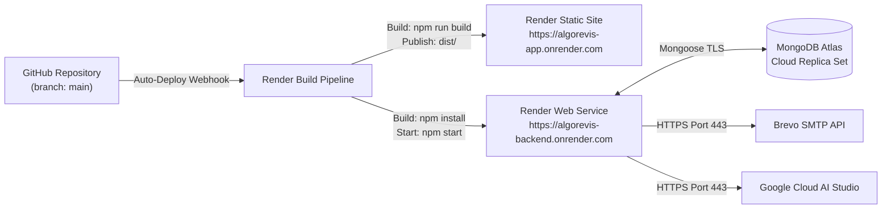

# 11. Deployment and DevOps — AlgoRevis

> 🚀 **Production Deployment & Operations Guide**: This document details the live deployment architecture on Render, continuous integration pipelines, environment configurations, and monitoring health checks.

---

## 1. Cloud Infrastructure & Hosting Topology

AlgoRevis is deployed across **Render Cloud Infrastructure** utilizing two distinct managed services:



---

## 2. Render Deployment Specifications

### A. Frontend Web Service
- **Service Type**: Static Site
- **Live URL**: [https://algorevis-app.onrender.com](https://algorevis-app.onrender.com)
- **Root Directory**: `frontend`
- **Build Command**: `npm install && npm run build`
- **Publish Directory**: `dist`
- **Routing Rules**: Rewrite all requests (`/*`) to `/index.html` (Single-Page Application routing).

### B. Backend Web Service
- **Service Type**: Web Service (Node.js Linux Container)
- **Live URL**: [https://algorevis-backend.onrender.com](https://algorevis-backend.onrender.com)
- **Root Directory**: `backend`
- **Build Command**: `npm install`
- **Start Command**: `npm start`
- **Health Check Path**: `/api/health`

---

## 3. Production Environment Variables

Configure the following environment variables in the Render Dashboard for the Backend Web Service:

| Variable Name | Required | Example / Description |
|---|:---:|---|
| `PORT` | Yes | `5000` (or injected by Render) |
| `NODE_ENV` | Yes | `production` |
| `MONGO_URI` | Yes | `mongodb+srv://<user>:<pwd>@cluster0.vdyvoi8.mongodb.net/?appName=Cluster0` |
| `JWT_SECRET` | Yes | High-entropy random 256-bit string |
| `CLIENT_URL` | Yes | `https://algorevis-app.onrender.com` |
| `BREVO_API_KEY` | Yes | `xkeysib-4f89c2c68ba5ba...` |
| `BREVO_SENDER_EMAIL`| Yes | Verified sender email (e.g. `harshsatyamsingh@gmail.com`) |
| `BREVO_SENDER_NAME` | No | `AlgoRevis` |
| `GEMINI_API_KEY` | Yes | Google Cloud Gemini API Key |
| `CLOUDINARY_CLOUD_NAME` | Optional | Cloudinary cloud account identifier |
| `CLOUDINARY_API_KEY` | Optional | Cloudinary API Key |
| `CLOUDINARY_API_SECRET`| Optional | Cloudinary API Secret |

---

## 4. Live Health Check & Telemetry

AlgoRevis exposes a dedicated health monitoring endpoint at `GET /api/health`:

- **URL**: `https://algorevis-backend.onrender.com/api/health`
- **Expected Status**: `200 OK`
- **Payload Schema**:
  ```json
  {
    "status": "healthy",
    "uptimeSeconds": 1420,
    "timestamp": "2026-10-25T12:05:00.000Z",
    "environment": "production",
    "database": {
      "connected": true,
      "readyState": 1,
      "host": "ac-efcpzep-shard-00-00.vdyvoi8.mongodb.net"
    },
    "services": {
      "scheduler": "active",
      "gemini": true,
      "email": true,
      "emailProvider": "brevo_https",
      "whatsapp": false
    }
  }
  ```

---

## 5. CI/CD & Automated Release Pipeline

1. **Local Development**: Developer creates feature branch or commits directly to `main`.
2. **Local Pre-Deployment Check**: Developer runs `node tests/httpRouteTests.js`.
3. **Git Push**: Push to `origin/main` (`git push origin main`).
4. **Render Automatic Trigger**: Render's GitHub webhook detects the commit on `main`, checks for modifications in `frontend` or `backend`, triggers parallel builds, runs smoke health checks, and switches traffic seamlessly without downtime.
