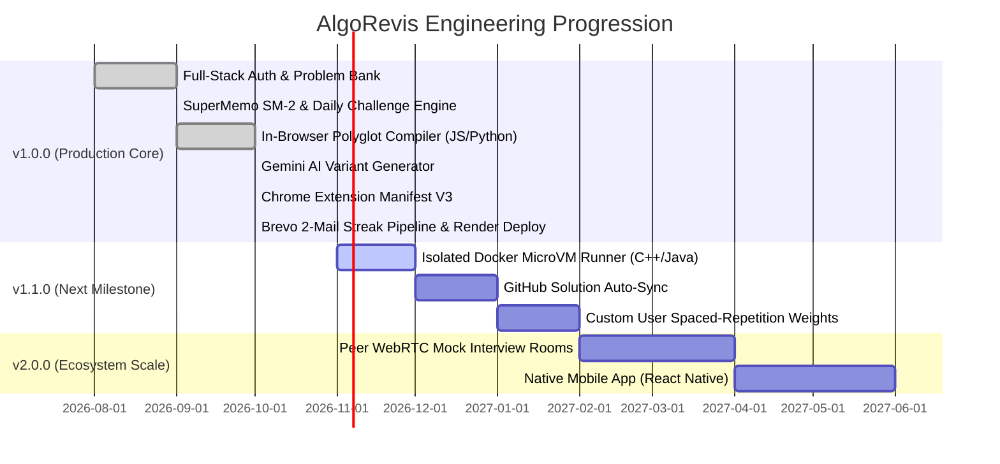

# 13. Roadmap and Future Improvements — AlgoRevis

> 🗺️ **Engineering Roadmap & Technical Debt Matrix**: This document outlines completed engineering milestones, active development targets, and long-term architectural possibilities.

---

## 1. Milestone Tracking

---

## 2. Completed Milestones (v1.0.0 Live)

| Milestone | Component | Business & Engineering Value |
|---|---|---|
| **Zero-Friction Authentication** | `routes/auth.js` | Eliminates signup drop-off while securing sessions with HTTP-only JWT cookies |
| **SuperMemo SM-2 Scheduler** | `services/revisionService.js` | Scientifically schedules recall problems to defeat the Ebbinghaus forgetting curve |
| **In-Browser Polyglot Compiler** | `services/codeExecutionService.js` | Provides real-time test execution for JavaScript and Python with execution telemetry |
| **Context-Aware AI Generation** | `services/aiService.js` | Uses Google Gemini to synthesize structured Question B variations with curated fallbacks |
| **Chrome Extension (MV3)** | `algorevis-extension/` | Scrapes LeetCode, GFG, and Codeforces directly into the user's personal revision bank |
| **Dual Daily Notification Pipeline**| `services/emailService.js` | 2 emails/day via Brevo HTTPS REST API (Morning Release + Evening Streak Alert) |
| **Cloud Image CDN** | `services/cloudinaryService.js` | Cloudinary integration supporting direct clipboard paste (`Ctrl+V`) for intuition drawings |

---

## 3. Active Queue (v1.1.0 Targets)

### 1. Isolated Docker MicroVM Sandbox for C++ and Java
- **Objective**: Extend compilation support beyond JavaScript and Python to compiled languages (C++20 with GCC/Clang and Java 21 OpenJDK).
- **Architecture**: Move from in-process VM execution to ephemeral, isolated Docker containers or Firecracker microVMs with strict memory (128MB) and CPU (0.5 core) cgroups.

### 2. GitHub Two-Way Solution Synchronization
- **Objective**: When a user completes a daily challenge or saves a problem, automatically commit their solution, intuition notes, and complexity analysis to a user-designated GitHub repository (`user/my-algo-revis-solutions`).
- **Implementation**: OAuth2 integration with GitHub API (`POST /repos/{owner}/{repo}/contents/{path}`).

### 3. Custom Spaced-Repetition Weight Tuning
- **Objective**: Allow users to adjust SM-2 parameters (e.g. strictness multipliers, default ease factors) based on whether they are doing long-term maintenance (6-month horizon) or aggressive interview cramming (2-week sprint).

---

## 4. Technical Debt & Architectural Improvements

| Area | Current Implementation | Proposed Future Refactoring | Impact |
|---|---|---|:---:|
| **Sandbox Execution** | In-process Node.js VM & Python CLI on same web instance | Dedicated asynchronous worker queue (BullMQ + Redis) executing in isolated worker containers | High |
| **Database Caching** | Direct Mongoose queries to MongoDB Atlas | Redis caching layer for `/api/challenges/today` and `/api/problems` | Medium |
| **Scheduler Concurrency**| Single-instance 60s timer loop | Distributed cron using BullMQ repeatable jobs or AWS EventBridge to enable horizontal backend scaling | High |
