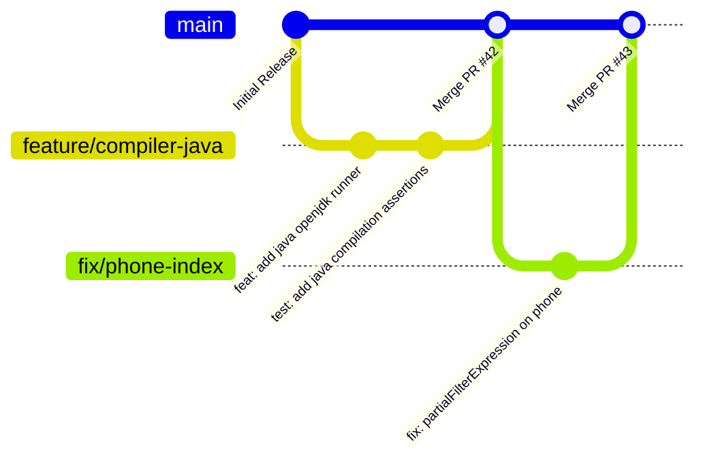

# 14. Contribution Guidelines — AlgoRevis

> 🤝 **Open Source Engineering Standards**: This document details the engineering conventions, Git branching model, commit guidelines, and pull request procedures for contributing to AlgoRevis.

---

## 1. Branching Strategy

AlgoRevis follows a streamlined **Trunk-Based / Feature-Branch Workflow**:



- **`main`**: Production-ready branch. Every push automatically deploys to Render.
- **`feature/<feature-name>`**: Active development of new capabilities (e.g. `feature/webrtc-mock-interview`).
- **`fix/<bug-description>`**: Hotfixes and bug resolutions (e.g. `fix/email-brevo-fallback`).
- **`docs/<topic>`**: Documentation updates (e.g. `docs/notion-api-specs`).

---

## 2. Commit Message Conventions (Conventional Commits)

Commit messages must follow the [Conventional Commits v1.0.0](https://www.conventionalcommits.org/) format:

```text
<type>(<optional scope>): <short description in imperative mood>

[optional body explaining rationale]

[optional footer(s)]
```

### Allowed Types
- **`feat`**: A new user-facing feature or API endpoint (e.g. `feat: add evening streak reminder via Brevo`).
- **`fix`**: A bug fix (e.g. `fix: prevent duplicate daily challenges on concurrent scheduler ticks`).
- **`docs`**: Documentation changes only (e.g. `docs: update Notion installation guide`).
- **`refactor`**: Code restructuring without altering external functionality.
- **`test`**: Adding missing tests or correcting existing tests.
- **`chore`**: Maintenance, dependency bumps, or build configuration adjustments.

---

## 3. Code Quality & Style Standards

### Backend (Node.js & Express 5)
1. **Asynchronous Handlers**: Always use `async/await` rather than raw callback chains. Express 5 natively catches unhandled rejected promises.
2. **Lean Route Controllers**: Place business logic inside `backend/services/` rather than embedding heavy database queries directly in router files.
3. **Mongoose Sanitization**: Never return raw user documents containing sensitive fields (`password`, `emailOTP`). Always use the model's `.toSafeObject()` method.

### Frontend (React 19 & TailwindCSS v4)
1. **Functional Components**: Use standard React functional components with reactive hooks (`useState`, `useEffect`, `useCallback`).
2. **Design Tokens**: Adhere to tokenized classes defined in `frontend/src/index.css`. Avoid hardcoded inline styles unless dynamically calculating dimensions.
3. **Accessibility**: All interactive buttons, modals, and tabs must include unique IDs and ARIA labels.

---

## 4. Pull Request (PR) Checklist

Before submitting a Pull Request, verify:

- [ ] All automated test suites pass locally (`node tests/httpRouteTests.js` and `node tests/randomPracticeIntegrationTests.js`).
- [ ] No hardcoded API keys, database credentials, or secrets are present in `.env` or code files.
- [ ] New API endpoints or schema modifications are documented in `notion_docs/06_api_documentation.md` and `notion_docs/05_database_design.md`.
- [ ] PR title adheres to Conventional Commits format.
