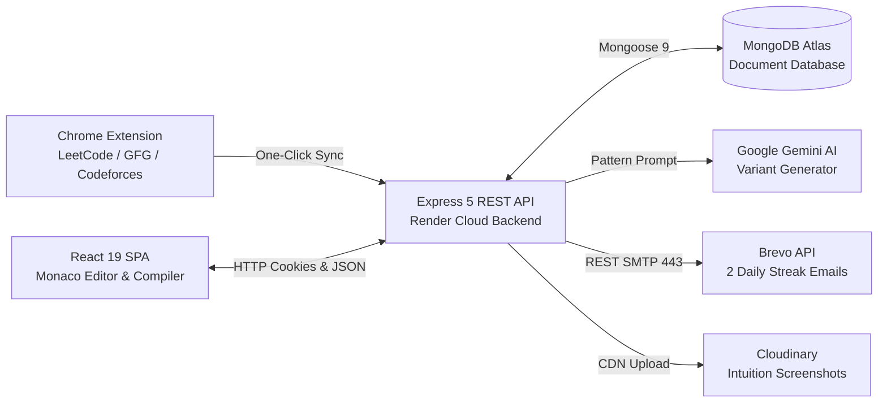

# 🚀 AlgoRevis — Notion Documentation Workspace

> **The Disciplined Curator for Algorithmic Mastery**  
> An intelligent, full-stack Data Structures & Algorithms (DSA) spaced-repetition platform, interactive polyglot compiler, and AI challenge generator.

---

## 🧭 Master Documentation Directory

Welcome to the official engineering and architecture documentation for **AlgoRevis**. This documentation suite is designed for engineers, system architects, recruiters, evaluators, and open-source contributors.

Each subpage is a self-contained, production-grade technical document optimized for Notion:

| # | Page Title | Core Topics Covered | Notion Link / File |
|---|---|---|---|
| **00** | [Project Home](./00_project_home.md) | Mission, Live Deployment, High-Level Architecture, Quick Links | [`00_project_home.md`](./00_project_home.md) |
| **01** | [Executive Summary](./01_executive_summary.md) | Problem Statement, Unique Value Proposition, Target Audience, Market Context | [`01_executive_summary.md`](./01_executive_summary.md) |
| **02** | [Requirements & Features](./02_requirements_and_features.md) | Functional/Non-Functional Specs, User Stories, Verified Feature Matrix | [`02_requirements_and_features.md`](./02_requirements_and_features.md) |
| **03** | [System Architecture](./03_system_architecture.md) | High-Level, Component & Deployment Architecture, Tech Stack Map | [`03_system_architecture.md`](./03_system_architecture.md) |
| **04** | [Data Flow & Process Diagrams](./04_data_flow_and_process_diagrams.md) | Mermaid Sequence & State Flows for Auth, Daily Cron, AI Gen, Sandboxed Code Exec | [`04_data_flow_and_process_diagrams.md`](./04_data_flow_and_process_diagrams.md) |
| **05** | [Database Design & Schemas](./05_database_design.md) | MongoDB Atlas Schemas, ERD Diagrams, Partial Indexes, Lifecycle, Data Access | [`05_database_design.md`](./05_database_design.md) |
| **06** | [API Specification](./06_api_documentation.md) | Comprehensive REST API Reference, Request/Response Payloads, Status Codes | [`06_api_documentation.md`](./06_api_documentation.md) |
| **07** | [Authentication & Security](./07_authentication_and_security.md) | JWT Cookies, Salted bcrypt, Collision-Free Phone Indexing, Sandbox Jail | [`07_authentication_and_security.md`](./07_authentication_and_security.md) |
| **08** | [Installation & Setup Guide](./08_installation_and_local_development.md) | Local Dev Setup, Backend, Frontend, Extension Loading, Env Variables | [`08_installation_and_local_development.md`](./08_installation_and_local_development.md) |
| **09** | [Codebase Architecture](./09_internal_codebase_documentation.md) | Directory Tree, Key Modules, Services, Controllers, Dependency Mapping | [`09_internal_codebase_documentation.md`](./09_internal_codebase_documentation.md) |
| **10** | [Testing & Quality Assurance](./10_testing_and_quality_assurance.md) | Automated Integration Test Suites, Pre-Deployment Gates, Edge Cases | [`10_testing_and_quality_assurance.md`](./10_testing_and_quality_assurance.md) |
| **11** | [Deployment & DevOps](./11_deployment_and_devops.md) | Render Web Services, Health Monitoring, Build Commands, CI/CD Pipeline | [`11_deployment_and_devops.md`](./11_deployment_and_devops.md) |
| **12** | [Troubleshooting & FAQ](./12_troubleshooting_and_faq.md) | Common Runtime Pitfalls, MongoDB Partial Index Gotchas, Sandbox Timeouts | [`12_troubleshooting_and_faq.md`](./12_troubleshooting_and_faq.md) |
| **13** | [Roadmap & Technical Debt](./13_roadmap_and_future_improvements.md) | Completed Milestones, Active Queue, Future Distributed Sandbox Architecture | [`13_roadmap_and_future_improvements.md`](./13_roadmap_and_future_improvements.md) |
| **14** | [Contribution Guidelines](./14_contribution_guidelines.md) | Git Branching Model, PR Conventions, Linting, Architecture Principles | [`14_contribution_guidelines.md`](./14_contribution_guidelines.md) |
| **15** | [Glossary & References](./15_glossary_and_references.md) | Spaced Repetition (SM-2), AST Scraping, Algorithmic Archetypes, API Specs | [`15_glossary_and_references.md`](./15_glossary_and_references.md) |
| **Guide** | [Notion Import Guide](./NOTION_IMPORT_GUIDE.md) | 1-Click Notion Import, Mermaid Block Configuration, Workspace Nesting | [`NOTION_IMPORT_GUIDE.md`](./NOTION_IMPORT_GUIDE.md) |

---

## ⚡ Quick Project Snapshot

- **Repository**: [https://github.com/harsh13satyam/ALGO_REVIS_.git](https://github.com/harsh13satyam/ALGO_REVIS_.git)
- **Live Frontend**: [https://algorevis-app.onrender.com](https://algorevis-app.onrender.com)
- **Live API Endpoint**: [https://algorevis-backend.onrender.com/api/health](https://algorevis-backend.onrender.com/api/health)
- **Chrome Extension**: Manifest V3 extension packaged with 1-click download in web app.
